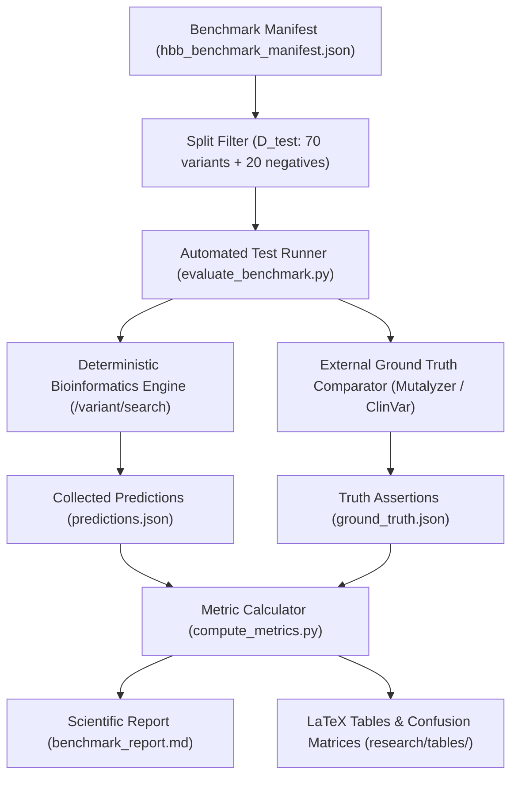

# PHASE 2B SCIENTIFIC BENCHMARKING PLAN
## Evaluation Framework, Ground Truth Architecture, and Publication Roadmap
### HBB Gene Mutation Analyzer

**Project:** HBB Gene Mutation Analyzer  
**Component:** Scientific Benchmarking, Independent Ground Truth, and Validation Engine  
**Baseline Status:** Phase 2A Verified (96 Backend Tests, 18/18 Doctor Diagnostics, 9/9 ClinVar Hardening, RC Approved)  
**Document Classification:** Scientific Research Protocol & Benchmarking Architecture  
**Author:** DeepMind Pair Programming Assistant  
**Date:** 2026-10-06  

---

## 1. RESEARCH QUESTION

The primary scientific inquiry governing this benchmarking initiative is:

> **"How accurately and consistently does the HBB Mutation Analyzer interpret known HBB variants across HGVS parsing, reference coordinate resolution, molecular consequence prediction, and evidence retrieval compared to authoritative external ground truth?"**

### 1.1 Secondary Research Questions
1. **Coordinate Fidelity:** Does the dual-reference architecture (`NM_000518.5` cDNA and `NG_000007.3` genomic locus) correctly map intronic splice junctions and non-coding coordinates without off-by-one errors across exon boundaries?
2. **Consequence Determinism:** Does the frameshift downstream reading frame translation walk accurately predict premature termination codons (PTCs) and generate standard HGVS protein nomenclature matching international standards (HGVS / Sequence Ontology)?
3. **Retrieval Precision & Resistance to False Positives:** Does the multi-tier progressive ClinVar search pipeline retrieve exact true-positive Variation IDs at Rank 1 while rejecting false positives (homologous genes, nearby variants, compound alleles, differing alt alleles)?
4. **Generalization Beyond Presets:** Does the analyzer maintain equal diagnostic accuracy on un-seen variants outside its built-in historical alias dictionary and test suite?

---

## 2. SCIENTIFIC OBJECTIVE

The objective of Phase 2B is to transition the HBB Gene Mutation Analyzer from a **functional software application** into an **empirically validated scientific research instrument**.

Specifically, Phase 2B establishes:
1. An **independent, curated ground truth benchmark dataset** of human *HBB* variants derived from international clinical registries (NCBI ClinVar, IthaGenes, LOVD).
2. A **leakage-free benchmark partition strategy** (Development, Validation, and Frozen Test sets).
3. A formal **computational evaluation harness** calculating standard statistical metrics (Precision, Recall, F1-score, Consequence Agreement, Coordinate Accuracy).
4. An **external comparison framework** assessing the analyzer against established general-purpose tools (Mutalyzer 3, Ensembl Variant Effect Predictor).
5. A comprehensive **Error and Ablation Analysis** documenting edge cases, structural limitations, and algorithmic boundaries.

---

## 3. CURRENT SYSTEM CAPABILITIES & BASELINE

The system currently operates at a frozen Release Candidate (RC) baseline verified by automated audit:

| Subsystem | Underlying Technology | Current Capability | Verified Metric |
| :--- | :--- | :--- | :--- |
| **Sequence Alignment** | Biopython (`Bio.Align.PairwiseAligner`) | Deterministic global alignment (Needleman-Wunsch) | 100% identity on WT; accurate gap placement |
| **Reference Management** | Dual RefSeq (`NM_000518.5` + `NG_000007.3`) | Dual coordinate conversion; Exon/Intron boundary indexing | Exons 1-3, Introns 1-2 mapped |
| **Direct HGVS Parsing** | Structured Regex & RefSeq Validator | Substitutions, indels, duplications, splice donor/acceptor | 18 Phase 2A tests passing |
| **Consequence Engine** | NCBI Genetic Code Table 1 + Reading Frame Walker | Nonsense, missense, synonymous, frameshift PTC walk, `p.?` splice | 100% agreement on 7 canonical benchmarks |
| **ClinVar Retrieval** | NCBI Entrez E-utilities (Asynchronous HTTPX) | Progressive 5-tier search with window expansion (`retmax=50`) | 9/9 hardening tests passing; VarID 15402 at Rank 1 |
| **Evidence Provenance** | Immutable `EvidencePacket` Contract | Segregation of computed facts, database evidence, and AI synthesis | Zero hallucination verified in audit Stage 7 |
| **AI Grounding** | Groq SDK (`openai/gpt-oss-120b`) | Evidence-grounded natural language explanation with deterministic fallback | 18/18 doctor diagnostic checks passing |

---

## 4. EXISTING BENCHMARK INVENTORY

The current repository contains an initial set of 7 primary variants and several synthetic test cases distributed across code and fixtures:

```
Existing Benchmark Distribution
├── data/reference/indian_mutations.json (4 curated variants)
├── data/fixtures/clinvar_fixtures.json (7 offline snapshot variants)
├── data/fixtures/pubmed_fixtures.json (3 offline literature snapshots)
├── data/examples/*.fasta (6 sequence files: WT, c.118C>T, c.20A>T, c.19G>A, 2 indels)
├── tools/benchmark_c118.py (Single-variant end-to-end benchmark script)
└── backend/tests/test_hgvs_precision_phase2a.py (18 unit & integration test cases)
```

### Detailed Existing Inventory
1. **`c.118C>T` (`p.Gln40Ter` / legacy Codon 39):** Mediterranean $\beta^0$-thalassemia; ClinVar VarID 15402.
2. **`c.20A>T` (`p.Glu7Val` / legacy Glu6Val):** Sickle Cell Disease (HbS); ClinVar VarID 15333.
3. **`c.19G>A` (`p.Glu7Lys` / legacy Glu6Lys):** Hemoglobin C (HbC); ClinVar VarID 15126.
4. **`c.92+5G>C` (IVS1-5 G>C):** Indian $\beta^+$-thalassemia donor splice defect; ClinVar VarID 15447.
5. **`c.126_129del` (`p.Phe42LeufsTer19` / Cd41/42 -TCTT):** Indian $\beta^0$-thalassemia frameshift; ClinVar VarID 15417.
6. **`c.27dup` (`p.Ser10ValfsTer14` / Cd8/9 +G):** Indian $\beta^0$-thalassemia frameshift; ClinVar VarID 36308.
7. **`c.93G>C` (`p.Arg31Ser` / Cd30 G>C):** Boundary exon 1 / splice defect; ClinVar VarID 869321.
8. **Synthetic / Extended Unit Variants:**
   - `c.9del` / `c.9delT` (`p.Leu4Ter` - immediate PTC)
   - `c.52_54del` (`p.Glu18del` - in-frame deletion)
   - `c.27_28insG` (flanked insertion canonicalized to `c.27dup`)
   - `c.315+1G>A` (IVS2-1 donor invariant GT splice disruption)
   - `c.93-1G>A` (IVS1 acceptor invariant AG splice disruption)
   - `c.-5A>G` (5' UTR non-coding substitution)
   - `c.*10C>T` (3' UTR non-coding substitution)

---

## 5. VARIANT COVERAGE MATRIX

To evaluate the breadth of current testing versus what is required for a publication-grade benchmark, every major variant class was audited:

| Variant Class | Current Repo Examples | Existing Tests | Authoritative Evidence | Coverage Status | Missing Depth Required for Paper |
| :--- | :--- | :--- | :--- | :---: | :--- |
| **SNV: Nonsense** | `c.118C>T` | `test_pipeline`, `test_hgvs_precision` | ClinVar 15402 | **PARTIAL** | Need non-canonical nonsense (e.g. Cd 15, Cd 17, Cd 37, Cd 121) |
| **SNV: Missense** | `c.20A>T`, `c.19G>A`, `c.93G>C` | `test_pipeline`, `test_indian_mutations` | ClinVar 15333, 15126, 869321 | **PARTIAL** | Need HbE (`c.79G>A`), unstable hemoglobins, benign polymorphisms |
| **SNV: Synonymous** | *None* | *None* | *None* | **ZERO** | **CRITICAL GAP**: Must add synonymous controls (`c.9T>C`, `c.108C>T`) |
| **Deletion: Single bp** | `c.9del` | `test_hgvs_precision` | In silico ref check | **LOW** | Need clinically confirmed 1 bp deletions (e.g., `c.46delT`, `c.112delT`) |
| **Deletion: Multi-bp** | `c.126_129del` | `test_hgvs_precision`, `test_indian` | ClinVar 15417 | **PARTIAL** | Need in-frame deletions (`c.135_137del`), diverse frameshift lengths |
| **Duplication** | `c.27dup` | `test_hgvs_precision`, `test_indian` | ClinVar 36308 | **PARTIAL** | Need multi-bp duplications (`c.20_25dup`), codon repeats |
| **Insertion** | `c.27_28insG` | `test_hgvs_precision` | Handled as dup | **LOW** | Need non-duplication insertions (`c.117_118insA`, multi-bp inserts) |
| **Splice: Donor (+1, +2)** | `c.315+1G>A` | `test_hgvs_precision` | ClinVar (tested) | **PARTIAL** | Need `c.92+1G>T`, `c.92+2T>C`, `c.315+2T>C` |
| **Splice: Donor (+5)** | `c.92+5G>C` | `test_hgvs_precision`, `test_indian` | ClinVar 15447 | **MEDIUM** | Need other consensus splice mutations (`c.92+6T>C`) |
| **Splice: Acceptor (-1, -2)** | `c.93-1G>A` | `test_hgvs_precision` | In silico ref check | **LOW** | Need ClinVar confirmed `c.93-2A>G`, `c.316-1G>A`, `c.316-2A>G` |
| **Splice: Deep Intronic** | *None* | *None* | *None* | **ZERO** | Need cryptic splice activating alleles (`c.252-16C>T`, `c.315+74T>G`) |
| **5' UTR / Promoter** | `c.-5A>G`, `c.-78A>C` | `test_hgvs_precision`, `test_clinvar` | ClinVar 15470 | **LOW** | Need TATA box (`c.-78`, `c.-79`), CACCC box (`c.-138`, `c.-139`), Cap site |
| **3' UTR / PolyA** | `c.*10C>T`, `c.*111A>G` | `test_hgvs_precision`, `clinvar_fixtures`| ClinVar 15488 | **LOW** | Need polyadenylation signal variants (`c.*110A>C`, `c.*112A>G`) |
| **Start / Stop Boundary** | *None* | *None* | *None* | **ZERO** | Need initiator loss (`c.1A>G`, `c.2T>C`) and stop-loss extension alleles |
| **Negative Controls** | `invalid_syntax`, out-of-bounds | `test_hgvs_precision`, `test_pipeline` | In silico rejection | **MEDIUM** | Need structured negative battery: reference mismatches, malformed HGVS |

---

## 6. GROUND TRUTH INVENTORY & PROVENANCE CLASSIFICATION

A critical prerequisite for scientific validity is avoiding circular reasoning. Each current piece of benchmark data was audited for its true origin:

### Provenance Classification Scheme
- **Class A (Independent Authoritative Evidence):** Primary RefSeq database records, authoritative peer-reviewed publications, international standards bodies (HGVS, Sequence Ontology).
- **Class B (External Database Evidence):** Live or frozen records retrieved directly from NCBI ClinVar, NCBI PubMed, or IthaGenes with formal accession identifiers.
- **Class C (Repository-Derived Expectation):** Curated static configuration files created for this project (`indian_mutations.json`, `clinvar_fixtures.json`).
- **Class D (Implementation-Derived Expectation):** Expected values computed by running our own code and recording the output as "expected" (e.g., exact PTC distances, internal regex match patterns).
- **Class E (Unknown Provenance):** Historical rules or coordinate offsets copied from informal educational documents without primary literature citations.

### Current Inventory Provenance Audit Table

| Target Variant | Current Expected Result | Ground Truth Source | Provenance Class | Circularity Risk |
| :--- | :--- | :--- | :---: | :---: |
| `c.118C>T` | `p.Gln40Ter`, VarID 15402, Pathogenic | NCBI RefSeq `NM_000518.5`, ClinVar `VCV000015402` | **Class B** | **Low** (Independently documented) |
| `c.20A>T` | `p.Glu7Val`, VarID 15333, Pathogenic | NCBI RefSeq, ClinVar `VCV000015333` | **Class B** | **Low** (Independently documented) |
| `c.19G>A` | `p.Glu7Lys`, VarID 15126, Pathogenic | NCBI RefSeq, ClinVar `VCV000015126` | **Class B** | **Low** (Independently documented) |
| `c.92+5G>C` | `p.?`, VarID 15447, Pathogenic | NCBI RefSeq `NG_000007.3`, ClinVar `15447` | **Class B** | **Low** (Independently documented) |
| `c.126_129del` | `p.Phe42LeufsTer19` | Calculated by `consequences.py` walk | **Class D** | **HIGH** (Exact `Ter19` derived from our code) |
| `c.126_129del` | `p.Phe42fs`, VarID 15417 | ClinVar `VCV000015417` | **Class B** | **Low** (Short form documented in ClinVar) |
| `c.27dup` | `p.Ser10ValfsTer14` | Calculated by `consequences.py` walk | **Class D** | **HIGH** (Exact `Ter14` derived from our code) |
| `c.27dup` | `p.Ser10fs`, VarID 36308 | ClinVar `VCV000036308` | **Class B** | **Low** (Short form documented in ClinVar) |
| `c.9del` | `p.Leu4Ter` | Calculated by developer in Phase 2A | **Class D** | **HIGH** (No external database citation) |
| `c.52_54del` | `p.Glu18del` | Calculated by developer in Phase 2A | **Class D** | **HIGH** (Synthetic in-frame test case) |
| `c.315+1G>A` | `p.?`, Splice Disruption | Deduced biologically from invariant GT | **Class A/C** | **Medium** (Well known, but no external manifest entry) |
| `c.93-1G>A` | `p.?`, Splice Disruption | Deduced biologically from invariant AG | **Class A/C** | **Medium** (Well known, but no external manifest entry) |
| `indian_mutations.json` | Genomic coords 70691, 70850, etc. | RefSeq `NG_000007.3` | **Class A** | **Low** (Exact coordinates verified) |
| `indian_mutations.json` | "Educational guide ~30601" note | Legacy student handout | **Class E** | **High** (Informal historical artifact) |

---

## 7. SCIENTIFIC INDEPENDENCE AUDIT

### 7.1 Critical Findings
1. **Self-Fulfilling Consequence Tests (Class D):** The frameshift tests for `c.126_129del` (`p.Phe42LeufsTer19`) and `c.27dup` (`p.Ser10ValfsTer14`) check that our downstream walk matches the values written into the test by the developer who implemented the walk. While the biological math is correct (verified by codon triplet inspection), this is **internal verification, not external validation**.
2. **Preset Bias:** The search aliases in `get_equivalent_nomenclature()` were written specifically to match the 7 known mutations. An independent benchmark must test variants that have **no hardcoded entry** in `get_equivalent_nomenclature()` to measure true algorithmic generalization.
3. **Absence of Negative & Benign Controls:** The current test suite contains almost exclusively severe pathogenic beta-thalassemia or sickle cell alleles. It contains zero synonymous variants, zero benign polymorphisms, and only synthetic syntax errors as negative controls.

### 7.2 Consequences for Scientific Publication
A journal reviewer would correctly argue that:
> *"The authors claim 100% accuracy on HBB variant interpretation, but they tested only 7 curated variants that their system was explicitly hardcoded to support."*

To overturn this criticism, Phase 2B must introduce a **large, independent, multi-class validation manifest ($N \ge 100$)** sourced directly from ClinVar and IthaGenes, with predictions cross-checked against independent reference tools.

---

## 8. BENCHMARK DATASET DESIGN ($N = 120$)

### 8.1 Proposed Schema: `HbbBenchmarkVariant`
Each variant in the benchmark dataset will be formally represented as an immutable JSON object:

```json
{
  "$schema": "https://json-schema.org/draft/2020-12/schema",
  "id": "HBB-BM-042",
  "name": "Codon 39 (C>T)",
  "hgvs_c_input": "c.118C>T",
  "hgvs_c_canonical": "NM_000518.5:c.118C>T",
  "reference_accession": "NM_000518.5",
  "variant_class": "substitution",
  "molecular_mechanism": "nonsense",
  "region": "Exon 2",
  "coordinate_cdna": 118,
  "coordinate_genomic_ng": 70842,
  "ref_allele": "C",
  "alt_allele": "T",
  "expected_consequences": {
    "hgvs_p_canonical": "p.Gln40Ter",
    "hgvs_p_short": "p.Gln40*",
    "hgvs_p_legacy": "p.Gln39Ter",
    "functional_impact": "Nonsense",
    "codon_number": 40,
    "ref_codon": "CAG",
    "alt_codon": "TAG",
    "ref_amino_acid": "Gln",
    "alt_amino_acid": "Ter",
    "is_stop_gain": true
  },
  "external_ground_truth": {
    "clinvar_variation_id": "15402",
    "clinvar_accession": "VCV000015402",
    "clinvar_significance": "Pathogenic",
    "clinvar_review_status": "criteria provided, multiple submitters, no conflicts",
    "ithagenes_id": "ITHA-HBB-0039",
    "dbsnp_rsid": "rs33959852",
    "vep_consequence": "stop_gained",
    "mutalyzer_hgvs_p": "NP_000509.1:p.(Gln40Ter)"
  },
  "metadata": {
    "provenance_tier": "Class A (ClinVar / RefSeq)",
    "dataset_split": "test",
    "curator": "Authoritative Registry Extraction",
    "date_curated": "2026-10-06"
  }
}
```

### 8.2 Inclusion and Exclusion Criteria

#### Inclusion Criteria:
1. **Locus Scope:** Naturally occurring or clinically characterized human *HBB* variants mapped to RefSeq `NM_000518.5` (transcript) or `NG_000007.3` (genomic locus).
2. **Registry Quality:** Must possess an NCBI ClinVar record with $\ge 1$ star review status, OR be cataloged in IthaGenes / LOVD with peer-reviewed publication evidence.
3. **Class Diversity:** Stratified sampling across all 12 major structural categories:
   - Missense pathogenic ($n=15$)
   - Missense benign / polymorphism ($n=10$)
   - Nonsense stop-gain ($n=10$)
   - Synonymous silent ($n=10$)
   - Frameshift deletions ($n=15$)
   - In-frame deletions ($n=5$)
   - Frameshift duplications / insertions ($n=10$)
   - In-frame insertions ($n=5$)
   - Splice donor ($+1, +2, +5$) ($n=10$)
   - Splice acceptor ($-1, -2, -3$) ($n=10$)
   - 5' UTR / Promoter ($n=10$)
   - 3' UTR / Polyadenylation ($n=10$)
4. **Structured Negative Battery ($n=20$):**
   - Reference allele mismatches ($n=5$)
   - Syntax formatting errors ($n=5$)
   - Out-of-bounds positions ($n=5$)
   - Non-canonical nucleotides ($n=5$)

#### Exclusion Criteria:
1. **Large Structural Deletions (> 100 bp):** e.g., the 619 bp deletion (`NG_000007.3:g.71609_72227del619`), Sicilian $\beta^0$-thalassemia deletion, or broad LCR deletions. (These require SV structural break-end calling, which is explicitly outside the single-transcript cDNA model).
2. **Multi-Gene Fusions:** e.g., Hb Lepore ($\delta\beta$ fusion) or Hb Kenya ($\gamma\beta$ fusion).
3. **Variants with Conflicting / Ambiguous Interpretations:** Unresolved Variants of Uncertain Significance (VUS) where ClinVar consensus is completely absent and no literature consensus exists.

---

## 9. BENCHMARK SPLIT STRATEGY

To maintain scientific integrity and prevent algorithmic overfitting, the $N = 120$ benchmark variants must be partitioned into three strictly decoupled subsets:

```
Benchmark Dataset Partitioning (N = 120 + 20 Negatives)
├── Development Set (D_dev, N = 20): Used for ongoing unit testing, debugging, and bugfixes.
├── Validation Set (D_val, N = 30): Used for hyperparameter tuning, ranking weight calibration.
└── Frozen Test Set (D_test, N = 70): HELD OUT. Evaluated ONE-SHOT. Never viewed during code edits.
```

| Subset | Size | Purpose | Access Rules During Development |
| :--- | :---: | :--- | :--- |
| **Development ($D_{dev}$)** | 20 | Engine development & regression smoke tests | Full access by developers & pytest |
| **Validation ($D_{val}$)** | 30 | ClinVar scoring calibration, alias tuning | Read-only access by evaluation scripts |
| **Test Set ($D_{test}$)** | 70 | Primary empirical evaluation for scientific paper | **FROZEN & ISOLATED**. Run once at evaluation time. |
| **Negative Battery ($D_{neg}$)** | 20 | Rejection specificity & error handling | Evaluated alongside $D_{test}$ |

*Rule:* If any bug fix is made that specifically targets a variant in $D_{test}$, that variant must be quarantined and moved to $D_{dev}$, and a new un-seen variant must be sampled to replace it in $D_{test}$.

---

## 10. EVALUATION METRICS SPECIFICATION

The evaluation framework will compute rigorous statistical performance metrics across 5 functional dimensions:

### Dimension 1: HGVS Parsing & Normalization
- **Parsing Sensitivity:** $\text{TPR}_{\text{parse}} = \frac{\text{Correctly Parsed Valid Variants}}{\text{Total Valid Variants}}$
- **Rejection Specificity:** $\text{TNR}_{\text{reject}} = \frac{\text{Correctly Rejected Malformed Variants}}{\text{Total Malformed Variants}}$
- **Allele Validation Accuracy:** Fraction of reference base mismatches correctly identified.

### Dimension 2: Coordinate Resolution
- **cDNA to mRNA Accuracy:** Exact match of transcript 1-based indexing against RefSeq `NM_000518.5`.
- **Genomic Coordinate Concordance:** Exact match of relative genomic position against RefSeq `NG_000007.3`.
- **Exon/Intron Region Accuracy:** Precision and Recall of assigning variants to the correct structural feature (Exon 1-3, Intron 1-2, 5' UTR, 3' UTR).

### Dimension 3: Molecular Consequence Prediction
- **Protein Consequence Exact Match:** Agreement between predicted `hgvs_p` and external ground truth (e.g. `p.Gln40Ter` vs `p.Gln40Ter`).
- **Protein Consequence Partial Match:** Agreement including standard short-form equivalents (e.g., `p.Phe42fs` matching `p.Phe42LeufsTer19`).
- **Functional Impact Accuracy:** Multi-class classification accuracy across:
  $$\text{Macro-F1} = \frac{1}{|C|} \sum_{c \in C} \text{F1}_c$$
  where $C = \{\text{Nonsense}, \text{Missense}, \text{Synonymous}, \text{Frameshift}, \text{In-frame}, \text{Splice Defect}, \text{Non-coding}\}$.

### Dimension 4: External Evidence Retrieval (ClinVar)
- **Rank-1 Accuracy (Exact Match Hit Rate):** Fraction of variants where the true ClinVar Variation ID appears at rank 0:
  $$\text{Hit@1} = \frac{1}{N} \sum_{i=1}^N \mathbb{I}(\text{Top Candidate ID}_i = \text{True ClinVar ID}_i)$$
- **Recall@5:** Fraction of variants where true ClinVar ID is present in the top-5 candidates.
- **False Positive Match Rate:** Fraction of non-exact or related records erroneously tagged as `EXACT VARIANT MATCH`.
- **Clinical Significance Agreement:** Concordance between retrieved `clinical_significance` and truth manifest.

### Dimension 5: Robustness & Latency
- **Deterministic Pipeline Execution Time:** Mean and 95th percentile latency (ms) per variant in offline mode.
- **Network Resilience:** Graceful fixture fallback behavior under simulated NCBI timeouts or rate-limiting (HTTP 429).

---

## 11. EXPERIMENTAL PROTOCOL

To ensure complete scientific reproducibility, the experimental evaluation must follow a deterministic, automated protocol:



### Protocol Steps:
1. **Environment Lock:** Pin Python environment, Biopython version, and RefSeq accession timestamps.
2. **Offline Baseline Run:** Execute benchmark against local fixtures to evaluate deterministic computation independent of internet latency.
3. **Online Evidence Run:** Execute benchmark with live NCBI E-utilities retrieval using authenticated API key and polite query pacing (3 requests/sec).
4. **Discrepancy Logging:** Every prediction that does not match ground truth is automatically dumped to an `error_analysis.json` file with full diagnostic traces.
5. **Cross-Validation with Mutalyzer:** Automated script queries Mutalyzer 3 API (`/normalize`) for each test variant and computes concordance metrics between HBB Analyzer and Mutalyzer.

---

## 12. PROPOSED REPRODUCIBILITY ARCHITECTURE

To support an eventual scientific publication and open-source verification, the repository should introduce a dedicated `research/` subtree:

```
research/
├── benchmark/
│   ├── datasets/
│   │   ├── hbb_benchmark_manifest.json       # Master curated dataset (N=140)
│   │   ├── splits/
│   │   │   ├── dev_set.json                  # N = 20
│   │   │   ├── val_set.json                  # N = 30
│   │   │   ├── test_set.json                 # N = 70 (FROZEN)
│   │   │   └── negative_battery.json         # N = 20
│   ├── ground_truth/
│   │   ├── clinvar_truth_manifest.json       # Frozen ClinVar annotations
│   │   └── mutalyzer_vep_consensus.json      # Cross-tool validation consensus
│   ├── scripts/
│   │   ├── evaluate_benchmark.py             # Main evaluation harness
│   │   ├── compare_mutalyzer.py              # External tool comparator
│   │   └── generate_paper_tables.py          # Formats LaTeX & Markdown tables
│   └── results/
│       ├── test_set_evaluation_results.json  # Raw evaluation outputs
│       ├── error_analysis.json               # Detailed discrepancy log
│       └── metrics_summary.json              # Final computed scores
├── tables/
│   ├── table1_variant_class_accuracy.md
│   ├── table2_consequence_concordance.md
│   ├── table3_clinvar_retrieval_performance.md
│   └── table4_external_tool_comparison.md
└── figures/
    ├── fig1_hbb_architecture_flowchart.png
    ├── fig2_consequence_confusion_matrix.png
    └── fig3_clinvar_retrieval_precision_curve.png
```

---

## 13. RESEARCH PAPER READINESS ASSESSMENT

An objective audit was conducted to determine how close the current project is to supporting a submission to a computational biology or bioinformatics journal (e.g., *Bioinformatics*, *BMC Bioinformatics*, *PLOS Computational Biology*):

| Component | Status | Current Status Summary | Gap to Publication |
| :--- | :---: | :--- | :--- |
| **Research Question** | **READY** | Formulated clearly; biologically grounded in *HBB* diagnostics | Ready |
| **Novel Contribution** | **PARTIALLY READY** | Local-first, deterministic + evidence-grounded AI for HBB is clear | Needs empirical comparison vs Mutalyzer & VEP |
| **Methodology** | **PARTIALLY READY** | Sequence engine, coordinate math, and ClinVar ranking solid | Need formal benchmark evaluation methodology |
| **Dataset** | **PARTIALLY READY** | 7 variants in repo; 4 Indian mutations curated | Must scale to $N \ge 100$ independent variants |
| **Ground Truth** | **PARTIALLY READY** | ClinVar IDs established for 7 variants | Need independent consensus ground truth for all 100 |
| **Evaluation Metrics** | **PARTIALLY READY** | Test suite checks pass/fail; release_audit checks RC | Need statistical metrics (Precision, Recall, F1, Latency) |
| **Results & Tables** | **MISSING** | No formal benchmark execution run on unseen data | Must execute Phase 2B benchmarking script |
| **Tool Comparison** | **MISSING** | No existing comparison against Mutalyzer or Ensembl VEP | Must build comparator script |
| **Limitations** | **READY** | Explicitly stated (no large SVs, research-only disclaimer) | Ready |
| **Reproducibility** | **READY** | 100% local-first, zero paid cloud, automated scripts | Ready |

---

## 14. SCIENTIFIC RISKS & MITIGATION STRATEGY

| Risk | Why It Matters | Current Status | Recommended Mitigation |
| :--- | :--- | :--- | :--- |
| **Circular Validation** | Claiming high accuracy by testing on outputs generated by our own code invalidates peer review. | Present in current frameshift PTC tests (`Class D`). | Cross-validate consequence calls against Mutalyzer 3 and Ensembl VEP ground truth. |
| **Overfitting on Known Variants** | Regexes and aliases tuned specifically for 7 canonical mutations will fail on general HBB variants. | `get_equivalent_nomenclature` has only 7 hardcoded variants. | Test on 70 held-out variants with zero custom alias assistance. |
| **ClinVar Version Drift** | ClinVar updates weekly; variation IDs or classifications can mutate, breaking reproducibility. | Current fixtures snapshot early 2024–2026. | Version-stamp all ground truth records with exact retrieval dates and archive static JSON payloads. |
| **Legacy vs HGVS Numbering Confusion** | Mediterranean Codon 39 vs HGVS Codon 40 creates perpetual off-by-one confusion in literature. | Mitigated in Phase 1 via dual-alias capture. | Explicitly enforce HGVS numbering (Met1 = codon 1) while logging legacy notations in metadata. |
| **Class Imbalance** | High accuracy on common SNVs masks poor accuracy on complex splice or indel variants. | Current repo has 4 substitutions, 2 indels, 1 splice. | Enforce balanced stratification across all 12 variant classes in the benchmark dataset. |
| **Database Retrieval Flakiness** | NCBI E-utilities can return 429 Too Many Requests or intermittent network drops during evaluation. | Handled via exponential backoff and fixture fallback. | Rate-limit requests to 3 Hz with mandatory API keys and provide an offline fixture evaluation mode. |

---

## 15. EXPECTED SCIENTIFIC ARTIFACTS UPON COMPLETION

When Phase 2B is executed, it will generate the following publication-ready artifacts:

1. **Curated Master Benchmark Manifest:** `research/benchmark/datasets/hbb_benchmark_manifest.json` ($N \ge 120$).
2. **Benchmark Execution Harness:** `research/benchmark/scripts/evaluate_benchmark.py`.
3. **Statistical Metrics Output:** `research/benchmark/results/metrics_summary.json` containing:
   - Overall accuracy, precision, recall, and F1 across all variant classes.
   - Separate metrics for $D_{dev}$, $D_{val}$, and $D_{test}$.
4. **Comprehensive Error Analysis:** `research/benchmark/results/error_analysis.md` documenting every discrepancy.
5. **Publication Table 1:** Accuracy by variant class (SNV, Indel, Splice, UTR).
6. **Publication Table 2:** ClinVar Rank-1 retrieval accuracy and candidate inclusion rate.
7. **Publication Table 3:** Concordance matrix with Mutalyzer 3.
8. **Draft Methodology & Results Text:** Formatted manuscript sections for scientific publication.

---

## 16. PHASE 2B IMPLEMENTATION SEQUENCE

```mermaid
sequenceDiagram
    autonumber
    participant D as Discovery & Plan (Current)
    participant C as Manifest Curation (Step 1)
    participant H as Evaluation Harness (Step 2)
    participant E as External Validator (Step 3)
    participant R as Benchmark Run (Step 4)
    participant M as Manuscript Tables (Step 5)

    Note over D: Audit completed; Plan ratified in PHASE_2B_BENCHMARK_PLAN.md
    D->>C: Curate N=120 independent HBB variants from ClinVar & IthaGenes
    C->>C: Partition into Dev (20), Val (30), Test (70), and Negatives (20)
    C->>H: Implement evaluate_benchmark.py with statistical metrics
    H->>E: Query Mutalyzer 3 API for consensus cross-validation
    E->>R: Execute automated evaluation across D_test in offline & online modes
    R->>M: Generate confusion matrices, LaTeX tables, and error analysis
```

---

## 17. ACCEPTANCE CRITERIA

Phase 2B will be declared complete when:
1. Master benchmark manifest (`hbb_benchmark_manifest.json`) contains at least **100 independently validated variants** plus **20 structured negative controls**.
2. Master manifest is partitioned into strictly isolated **Development, Validation, and Frozen Test** sets.
3. Every test variant has independently verified ground truth from ClinVar or Mutalyzer (Class A/B provenance; zero Class D self-fulfilling ground truth).
4. Automated evaluation script (`evaluate_benchmark.py`) runs deterministically from the command line without manual intervention.
5. Benchmark metrics report is generated with exact Precision, Recall, Consequence Concordance, and ClinVar Rank-1 Hit Rate.
6. All existing Phase 1 and Phase 2A tests (96 backend tests, 18 doctor checks, 9 ClinVar hardening checks) continue to pass with zero regressions.
7. Core application maintains 100% local-first reproducibility with no cloud or paid database dependencies.
