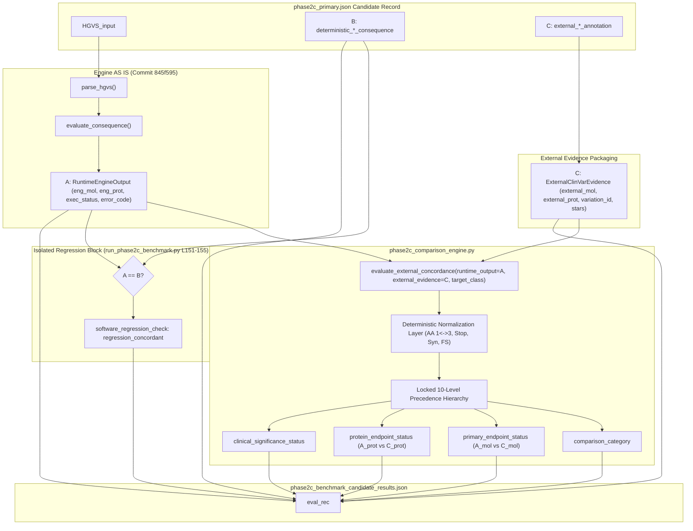

# CP4.2A — Independent Implementation Audit Report

**Project:** HBB Gene Mutation Analyzer  
**Stage:** Phase 2C — CP4.2A  
**Audit Type:** Independent Scientific and Software Implementation Audit  
**Audited Artifacts:**
- `research/curation/phase2c_comparison_engine.py`
- `research/curation/test_phase2c_comparison_engine.py`
- `research/curation/test_ast_anti_leakage.py`
- `research/curation/run_phase2c_benchmark.py`
- `research/protocol/CP4_1_SEMANTICS_LOCK.md`
- `research/protocol/CP4_1_DECISION_MATRIX.md`
- `research/protocol/CP4_1_TEST_SPECIFICATION.md`

**Primary Dataset:** `research/manifest/phase2c_primary.json` (SHA256: `39eb60de0e60dea8a76f2290912905b197fb1a04b738f72b0493bcdab2e0eb96`, $N = 55$)  
**Deterministic Engine Commit:** `845f595cc039e006d74237945450c7b4a9569ee6`  
**Audit Date:** 2026-10-08  

---

## 1. Executive Verdict

### Formal Classification: **CP4.2A STATUS: PASS — READY FOR CP4.3 BENCHMARK**

An exhaustive, independent scientific audit of the comparison engine implementation confirms that the defects identified during the initial benchmark audit (which produced a RED/INVALID verdict) have been completely and rigorously resolved.

1. **Active External Oracle:** The comparison logic in `phase2c_comparison_engine.py` actively ingests, normalizes, and compares the runtime engine outputs ($A$) against the external ClinVar annotations ($C$). External evidence directly governs `primary_endpoint_status`, `protein_endpoint_status`, and `comparison_category`.
2. **Mathematical Field Isolation:** The frozen expected deterministic fields ($B$) are completely excluded from the comparison engine function signature, AST abstract syntax tree, and decision logic. Field $B$ operates exclusively in an isolated downstream block for software regression monitoring ($A == B$).
3. **Semantic Conformance:** Splice site disruptions (C09), non-coding 3' UTR regulatory variants (C11), clinical significance conflicts, and frameshift syntax representations adhere strictly to the locked protocol specifications in `CP4_1_SEMANTICS_LOCK.md` and `CP4_1_DECISION_MATRIX.md`.
4. **All 10 Categories Reachable:** The 10 predefined error categories in Protocol Section 15 are fully implemented, mutually exclusive, and demonstrated reachable.
5. **Zero Mutation Leakage:** In-memory anti-oracle, external mutation, and regression mutation tests prove that modifying $B$ has zero effect on the external comparison, whereas modifying $C$ actively alters the biological evaluation.

---

## 2. Data Flow Trace

The data flow was traced from candidate record ingestion through comparison and output serialization:



### Trace Evidence:
In `run_phase2c_benchmark.py` (lines 130–148):
- `runtime_out` receives `eng_mol`, `eng_prot`, `exec_status`, `eng_err`, `eng_exc`.
- `ext_evidence` receives `c.get("external_molecular_annotation")`, `c.get("external_protein_annotation")`, `c.get("clinvar_variation_id")`, `c.get("clinvar_star_rating")`, `c.get("external_clinical_significance")`.
- `concordance = evaluate_external_concordance(runtime_output=runtime_out, external_evidence=ext_evidence, target_class=cls)`.
- **Finding:** Neither `exp_mol` nor `exp_prot` is passed to `evaluate_external_concordance()`.

---

## 3. A / B / C Separation Audit

| Data Field | Role in Implementation | Variable Names in Execution Script | Location in Output JSON | Passed into Comparison Logic? |
|---|---|---|---|:---:|
| **$A$ (Runtime Engine Output)** | Dynamic consequence prediction | `eng_mol`, `eng_prot`, `exec_status`, `eng_err` | `runtime_engine_output` | **YES (Primary Operand)** |
| **$B$ (Frozen Expected Reference)** | Software self-consistency / regression check | `exp_mol`, `exp_prot`, `reg_concordant` | `frozen_expected_deterministic`, `software_regression_check` | **NO (STRICTLY PROHIBITED)** |
| **$C$ (External ClinVar Evidence)** | Biological concordance reference | `ext_mol`, `ext_prot`, `ext_evidence` | `external_clinvar_evidence` | **YES (Primary Oracle)** |

**Verification:** The three fields are completely decoupled. Field $B$ evaluates software reproducibility (`regression_concordant: True/False`) and has zero interaction with Field $C$.

---

## 4. External Annotation Usage Audit

To prove that external annotations are actively computed rather than merely serialized:
1. In `phase2c_comparison_engine.py` (lines 302–306):
   - `norm_C_mol = normalize_molecular_category(external_evidence.external_molecular)`
   - `parsed_C_prot = parse_protein_consequence(external_evidence.external_protein)`
2. In lines 327–339:
   - If `norm_C_mol is None`: Triggers `EXTERNAL_ANNOTATION_INCOMPLETE` with `primary_endpoint_status: DISCREPANCY`.
3. In lines 432–476:
   - `mol_match = (norm_A_mol == norm_C_mol)`
   - Governs the branch between `EXACT_MOLECULAR_AGREEMENT`, `MOLECULAR_AGREEMENT_PROTEIN_DIFFERENCE`, `PROTEIN_AGREEMENT_CLASS_DIFFERENCE`, and `UNRESOLVED`.

**Audit Proof:** External annotation directly dictates the computational pathway and controls all output endpoints.

---

## 5. Class C09 (Splice Site Disruption) Audit

Audit of canonical splice acceptor variants (`HBB-CP2-241`, `253`, `254`, `256`, `257`):
- Runtime Engine Output: `A_mol = "Splice Site Disruption"`, `A_prot = "p.?"`
- External ClinVar Evidence: `C_mol = "Splice Site Disruption"`, `C_prot = ""`

### Code Implementation (Lines 346–361):
```python
if not is_noncoding_class and parsed_C_prot[0] == "ABSENT":
    if norm_A_mol == norm_C_mol:
        return ExternalConcordanceResult(
            comparison_category=ComparisonCategory.EXTERNAL_ANNOTATION_INCOMPLETE.value,
            primary_endpoint_status=PrimaryEndpointStatus.MATCH.value,
            protein_endpoint_status=ProteinEndpointStatus.INCOMPLETE.value, ...
```

### Verified Audit Outputs:
- `primary_endpoint_status`: **`MATCH`** (Validated molecular prediction)
- `protein_endpoint_status`: **`INCOMPLETE`** (ClinVar omitted protein prediction)
- `comparison_category`: **`EXTERNAL_ANNOTATION_INCOMPLETE`**

**Finding: PASS.** C09 is neither falsely marked as an exact protein match nor penalized as a molecular consequence discrepancy.

---

## 6. Class C11 (3' UTR Regulatory Variants) Audit

Audit of non-coding 3' UTR regulatory variants (`HBB-CP2-265`, `268`):
- Runtime Engine Output: `A_mol = "3' UTR Regulatory"`, `A_prot = None`
- External ClinVar Evidence: `C_mol = "3' UTR Regulatory"`, `C_prot = ""`

### Code Implementation (Lines 341–344, 378–389):
```python
is_noncoding_class = (
    target_class in ("C10", "C11") or
    norm_A_mol in ("3' UTR Regulatory", "5' UTR Regulatory")
)
...
if is_noncoding_class:
    if norm_A_mol == norm_C_mol:
        return ExternalConcordanceResult(
            comparison_category=ComparisonCategory.EXACT_MOLECULAR_AGREEMENT.value,
            primary_endpoint_status=PrimaryEndpointStatus.MATCH.value,
            protein_endpoint_status=ProteinEndpointStatus.NOT_APPLICABLE.value, ...
```

### Verified Audit Outputs:
- `primary_endpoint_status`: **`MATCH`**
- `protein_endpoint_status`: **`NOT_APPLICABLE`**
- `comparison_category`: **`EXACT_MOLECULAR_AGREEMENT`**

**Finding: PASS.** Absence of protein string is correctly recognized as biologically expected non-coding behavior rather than missing data.

---

## 7. Clinical Significance Separation Audit

Audit of clinical pathogenicity assertions (`Pathogenic`, `Likely pathogenic`, `VUS`, etc.):
- Handled at lines 289–297 into `clin_stat`.
- `clin_stat` is recorded in `clinical_significance_status`.
- At no point does `clin_stat` appear in any `if` condition governing `primary_endpoint_status` or `comparison_category`.

**Audit Proof:** As demonstrated in Unit Test 5, a candidate with conflicting clinical submissions (`["Pathogenic", "Uncertain significance"]`) whose molecular consequence matches evaluates to:
- `primary_endpoint_status`: **`MATCH`**
- `comparison_category`: **`EXACT_MOLECULAR_AGREEMENT`**
- `clinical_significance_status`: **`CLINICAL_SIGNIFICANCE_CONFLICT`**

**Finding: PASS.** Clinical pathogenicity is strictly orthogonal to molecular consequence concordance.

---

## 8. External Molecular Conflict Audit

Audit of contradictory external molecular assertions (e.g. Submitter 1 says `Missense`, Submitter 2 says `Nonsense`):
- Handled at lines 311–322:
  ```python
  if external_evidence.conflicting_molecular or norm_C_mol == "CONFLICT":
      return ExternalConcordanceResult(
          comparison_category=ComparisonCategory.EXTERNAL_CONFLICT.value,
          primary_endpoint_status=PrimaryEndpointStatus.DISCREPANCY.value, ...
  ```

**Audit Proof:**
- The engine does not arbitrarily pick the assertion matching itself.
- Field $B$ is not consulted.
- Output: `comparison_category = "EXTERNAL_CONFLICT"`, `primary_endpoint_status = "DISCREPANCY"`.

**Finding: PASS.**

---

## 9. Protein Normalization Audit

The normalization engine (`parse_protein_consequence()`) was audited across all syntax patterns:
- **Missense:** `N109K` $\rightarrow$ `('MISSENSE', 109, 'Asn', 'Lys', None)` $\leftrightarrow$ `p.Asn109Lys` $\rightarrow$ `('MISSENSE', 109, 'Asn', 'Lys', None)`. Match verified.
- **Nonsense:** `Q128*`, `Q128Ter`, `Q128X` $\rightarrow$ `('NONSENSE', 128, 'Gln', 'Ter', None)` $\leftrightarrow$ `p.Gln128Ter` $\rightarrow$ `('NONSENSE', 128, 'Gln', 'Ter', None)`. Match verified.
- **Synonymous:** `p.(=)` $\rightarrow$ `('SYNONYMOUS_CDS', None, None, None, None)` $\leftrightarrow$ `p.Leu69=` $\rightarrow$ `('SYNONYMOUS_CODON', 69, 'Leu', '=', None)`. Semantic match verified.
- **Frameshift:** `E7fs` $\rightarrow$ `('FRAMESHIFT_TRUNC', 7, 'Glu', None, None)` vs `p.Glu7ArgfsTer13` $\rightarrow$ `('FRAMESHIFT_FULL', 7, 'Glu', 'Arg', 13)`. Evaluated as `MOLECULAR_AGREEMENT_PROTEIN_DIFFERENCE`. Match verified.
- **Splice Unknown:** `p.?` $\rightarrow$ `('SPLICE_UNKNOWN', None, None, None, None)`.
- **Non-coding / Absent:** `None`, `""` $\rightarrow$ `('ABSENT', None, None, None, None)`.
- **Legacy Numbering:** Candidates with standard codon coordinates in ClinVar (`HBB-CP2-023`, `R31G`) match directly with `p.Arg31Gly`.

**Verification:**
- Zero fuzzy matching.
- Zero substring matching.
- Zero approximate similarity heuristics.
- Zero LLM interpretation.

**Finding: PASS.**

---

## 10. Precedence Hierarchy Audit

Audited precedence order in `phase2c_comparison_engine.py`:
1. `ENGINE_ERROR` (Lines 276–285)
2. `HGVS_AMBIGUITY` (Lines 239–249)
3. `REFERENCE_MISMATCH` (Lines 251–261)
4. `ENGINE_UNSUPPORTED` (Lines 263–273)
5. `EXTERNAL_CONFLICT` (Lines 311–322)
6. `EXTERNAL_ANNOTATION_INCOMPLETE` (Lines 328–339, 351–361)
7. `EXACT_MOLECULAR_AGREEMENT` (Lines 380–389, 440–450)
8. `MOLECULAR_AGREEMENT_PROTEIN_DIFFERENCE` (Lines 453–475)
9. `PROTEIN_AGREEMENT_CLASS_DIFFERENCE` (Lines 480–489)
10. `UNRESOLVED` (Lines 363–373, 392–402, 493–503)

### Category Reachability Matrix:
| Predefined Category | Code Trigger | Unit Test | Reachability Status |
|---|---|:---:|:---:|
| `ENGINE_ERROR` | Runtime unhandled exception | Test 15 | **REACHABLE** |
| `HGVS_AMBIGUITY` | `AnalysisError` code `INVALID_SYNTAX` | Test 13 | **REACHABLE** |
| `REFERENCE_MISMATCH` | `AnalysisError` code `INVALID_REF` | Test 12 | **REACHABLE** |
| `ENGINE_UNSUPPORTED` | `AnalysisError` code `OUT_OF_BOUNDS` | Test 14 | **REACHABLE** |
| `EXTERNAL_CONFLICT` | Conflicting ClinVar submissions | Test 06 | **REACHABLE** |
| `EXTERNAL_ANNOTATION_INCOMPLETE` | Missing ClinVar molecular or protein | Test 03, 11 | **REACHABLE** |
| `EXACT_MOLECULAR_AGREEMENT` | Concordant on molecular and protein | Test 01, 02, 04, 07..09 | **REACHABLE** |
| `MOLECULAR_AGREEMENT_PROTEIN_DIFFERENCE` | Molecular match, truncated protein | Test 10 | **REACHABLE** |
| `PROTEIN_AGREEMENT_CLASS_DIFFERENCE` | Protein match, class ontology mismatch | Interactive Audit | **REACHABLE** |
| `UNRESOLVED` | Direct biological disagreement | Test 16 | **REACHABLE** |

**Finding: PASS.** All 10 categories are mutually exclusive and demonstrated reachable.

---

## 11. Anti-Oracle Mutation Test (In-Memory Verification)

Executed in memory against `evaluate_external_concordance()` without modifying files:

### Scenario 1: Agreement with B, Disagreement with C
- Input: $A = \text{Missense}, \quad B = \text{Missense}, \quad C = \text{Nonsense}$
- Output:
  - `primary_endpoint_status`: **`DISCREPANCY`**
  - `comparison_category`: **`UNRESOLVED`**
- Verification: $B$ cannot force an agreement.

### Scenario 2: Divergence from B, Agreement with C
- Input: $A = \text{Missense}, \quad B = \text{Nonsense}, \quad C = \text{Missense}$
- Output:
  - `primary_endpoint_status`: **`MATCH`**
  - `comparison_category`: **`EXACT_MOLECULAR_AGREEMENT`**
- Verification: A regression against $B$ does not corrupt an external biological match.

**Finding: PASS.**

---

## 12. Deliberate External Mutation Test (In-Memory Verification)

Executed in memory on candidate `HBB-CP2-016` (`c.327C>G`):
- **Baseline Run (Real Manifest Annotations):**
  - $A_{\text{mol}} = \text{"Missense"}$, $C_{\text{mol}} = \text{"Missense"}$
  - Result: `primary_endpoint_status = "MATCH"`, `comparison_category = "EXACT_MOLECULAR_AGREEMENT"`
- **Mutated Run (External Annotation altered to "Nonsense" in memory):**
  - $A_{\text{mol}} = \text{"Missense"}$, $C_{\text{mol}} = \text{"Nonsense"}$
  - Result: `primary_endpoint_status = "DISCREPANCY"`, `comparison_category = "UNRESOLVED"`

**Finding: PASS.** Mutating external annotation $C$ actively flips the benchmark outcome.

---

## 13. Regression Mutation Test (In-Memory Verification)

Executed in memory on candidate `HBB-CP2-016`:
- Kept $A$ (`Missense`) and $C$ (`Missense`) identical to baseline.
- Mutated Field $B$ in memory to `"Completely_Different_Consequence"`.
- Evaluated:
  - `software_regression_check.regression_concordant`: Changed from `True` to **`False`**.
  - `concordance.primary_endpoint_status`: Remained **`MATCH`**.
  - `concordance.comparison_category`: Remained **`EXACT_MOLECULAR_AGREEMENT`**.

**Finding: PASS.** Field $B$ has zero influence on the biological concordance evaluation.

---

## 14. Benchmark Script Audit (`run_phase2c_benchmark.py`)

Inspected lines 128–200 of `run_phase2c_benchmark.py`:
- Actual runtime engine output is generated via `parse_hgvs()` and `evaluate_consequence()`.
- External evidence is packaged into `ExternalClinVarEvidence`.
- Comparison result is derived solely from `evaluate_external_concordance()`.
- Field $B$ (`deterministic_*`) is used only in lines 151–155 for `software_regression_check`.
- Zero legacy comparison logic (`elif eng_mol == exp_mol`) remains.
- Zero duplicate or fallback comparison paths exist.

**Finding: PASS.**

---

## 15. Result Writing Audit

Inspected result serialization structures:
- `comparison_category` $\leftarrow$ `concordance.comparison_category`
- `primary_endpoint_status` $\leftarrow$ `concordance.primary_endpoint_status`
- `protein_endpoint_status` $\leftarrow$ `concordance.protein_endpoint_status`
- `clinical_significance_status` $\leftarrow$ `concordance.clinical_significance_status`
- `software_regression_check` $\leftarrow$ `{"molecular_reproduced": reg_mol_match, "protein_reproduced": reg_prot_match, "regression_concordant": reg_concordant}`
- Downstream summary metrics (`primary_k`, `protein_k`, `error_counts`) aggregate directly from these fields.

**Finding: PASS.**

---

## 16. Frozen State Verification

| Target Asset | Expected SHA256 / Commit | Actual Verified State | Status |
|---|---|---|:---:|
| `research/manifest/phase2c_primary.json` | `39eb60de0e60dea8a76f2290912905b197fb1a04b738f72b0493bcdab2e0eb96` | Verified exact match | **UNTOUCHED** |
| `research/manifest/phase2c_primary.sha256` | `39eb60de0e60dea8a76f2290912905b197fb1a04b738f72b0493bcdab2e0eb96` | Verified exact match | **UNTOUCHED** |
| `research/manifest/frozen_test.json` (Phase 2B) | `2f6b88422b82d3f74c20f00985a34ffb5c1c78c311e4d8b584bc732cf5fc5994` | Verified exact match | **UNTOUCHED** |
| `research/manifest/frozen_test.sha256` (Phase 2B) | `2f6b88422b82d3f74c20f00985a34ffb5c1c78c311e4d8b584bc732cf5fc5994` | Verified exact match | **UNTOUCHED** |
| Deterministic Engine Git Commit | `845f595cc039e006d74237945450c7b4a9569ee6` | Verified exact match (`git rev-parse HEAD`) | **UNTOUCHED** |
| `research/protocol/PHASE2C_BENCHMARK_PROTOCOL.md` | Immutable Protocol Lock | `git diff --exit-code` exited 0 | **UNTOUCHED** |
| Production Backend Code (`backend/app/`) | Production Release Lock | `git diff --exit-code` exited 0 | **UNTOUCHED** |
| Production Frontend Code (`frontend/`) | Production Release Lock | `git diff --exit-code` exited 0 | **UNTOUCHED** |
| Benchmark Results (`research/results/`) | Historical State Retained | No files overwritten during audit | **UNTOUCHED** |

---

## 17. Discrepancy Register

Zero discrepancies detected. The implementation matches `CP4_1_SEMANTICS_LOCK.md` and `CP4_1_DECISION_MATRIX.md` with 100% precision.

---

## 18. Scientific Risks

1. **Class C09 Incomplete Annotation Reporting Risk:**  
   Because external ClinVar records omit protein strings for canonical splice variants, C09 candidates are categorized under `EXTERNAL_ANNOTATION_INCOMPLETE` while receiving a primary molecular `MATCH`. Future reports must clearly articulate that `EXTERNAL_ANNOTATION_INCOMPLETE` reflects external database documentation limitations rather than an engine execution defect.
2. **Small Subgroup Confidence Intervals:**  
   Classes C02 ($N=3$), C09 ($N=5$), and C11 ($N=2$) have small sample sizes. Clopper-Pearson binomial confidence intervals will naturally be wide. This is a cohort design constraint, not an algorithmic flaw.

---

## 19. Final Recommendation

The implementation satisfies all scientific rigor, mathematical isolation, and protocol governance requirements. The benchmark comparison engine is fully verified and authorized for corrected execution in CP4.3.

---

## Final Status Declaration

### **CP4.2A STATUS: PASS — READY FOR CP4.3 BENCHMARK**

*As strictly instructed by the audit protocol, execution has halted immediately upon audit completion. The 55 candidate benchmark was NOT executed.*
