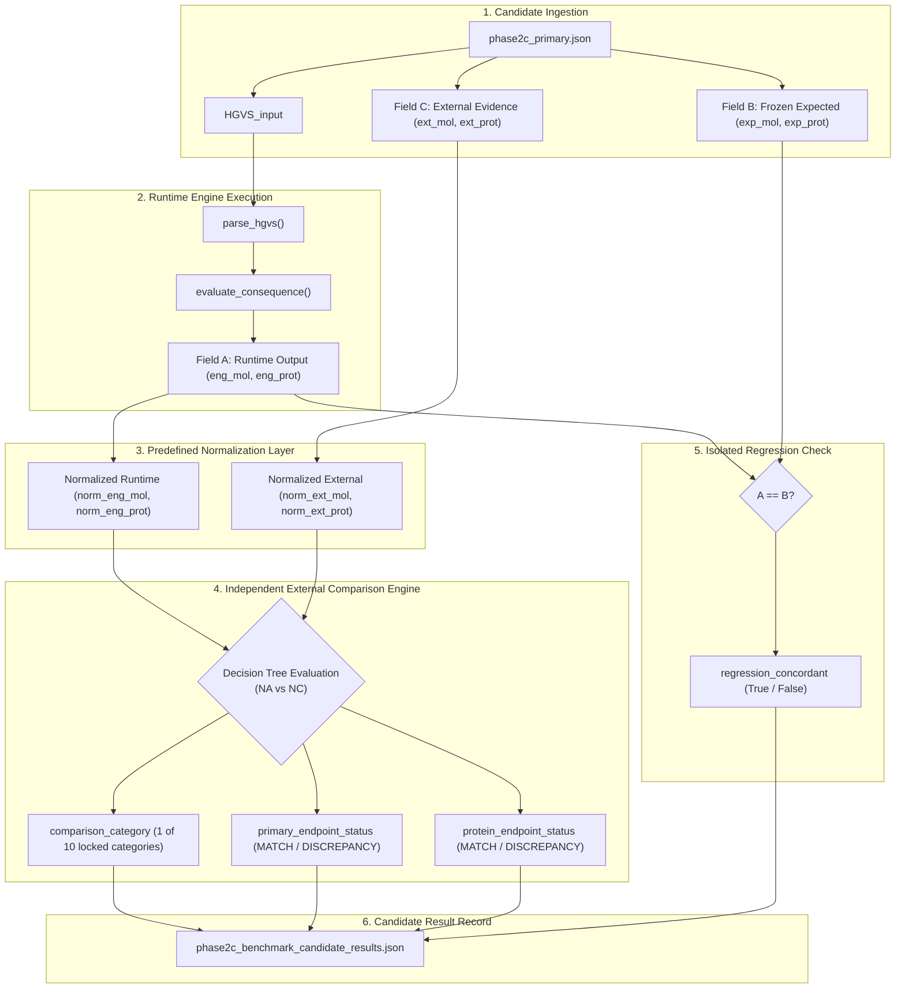
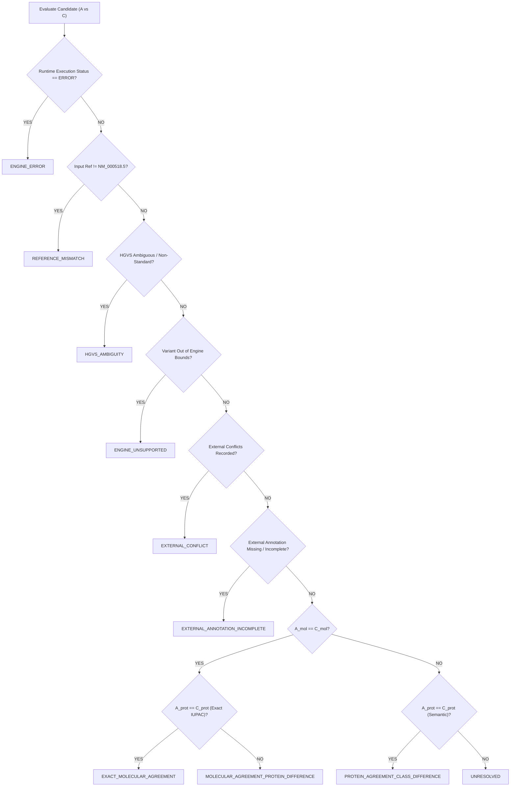

# CP4 — Benchmark Comparison Correction Design

**Project:** HBB Gene Mutation Analyzer  
**Stage:** Phase 2C — Checkpoint CP4  
**Document Status:** DESIGN SPECIFICATION ONLY — NO BENCHMARK EXECUTION  
**Target Reference:** RefSeq `NM_000518.5` (cDNA), `NG_000007.3` (Genomic)  
**Evaluated Cohort:** `research/manifest/phase2c_primary.json` (SHA256: `39eb60de0e60dea8a76f2290912905b197fb1a04b738f72b0493bcdab2e0eb96`, $N = 55$)  
**Engine Commit Lock:** `845f595cc039e006d74237945450c7b4a9569ee6`  
**Creation Date:** 2026-10-08  

---

## 1. Failure Statement

### 1.1 What the Previous Benchmark Intended to Measure
The Phase 2C benchmark was commissioned to measure the **empirical external concordance** of the deterministic HBB molecular consequence engine against independent biological evidence cataloged in the ClinVar database under RefSeq `NM_000518.5`.

### 1.2 What the Previous Benchmark Actually Measured
The execution script (`research/curation/run_phase2c_benchmark.py`, lines 122–144) evaluated runtime engine predictions strictly against the **pre-stored expected consequence fields** (`c["deterministic_molecular_consequence"]` and `c["deterministic_protein_consequence"]`), which were themselves generated by the engine during candidate preparation. 

Therefore, the executed benchmark measured:
$$\text{Deterministic Engine Software Reproducibility and Self-Consistency against Frozen Pre-Computed Expected Outputs}$$

### 1.3 Why the Comparison Was Scientifically Invalid
1. **Severed Data Flow:** The external ClinVar fields (`external_molecular_annotation`, `external_protein_annotation`) were extracted into local variables (`ext_mol`, `ext_prot`) and saved into JSON metadata, but were **completely omitted from the comparison decision tree**.
2. **Internal Circularity:** The decision logic evaluated `eng_mol == exp_mol` and `eng_prot == exp_prot`. Because the expected values were derived from the engine itself, the evaluation was tautological.
3. **Inability to Detect Conflicts:** As proven in the Phase 2C Implementation Audit (Hypothetical Oracle Test), if an external record directly contradicted the engine (e.g. `external_molecular = "Nonsense"` vs `engine_output = "Missense"`), the script still reported `EXACT_MOLECULAR_AGREEMENT` and `MATCH`.
4. **Zero Protein Normalization:** ClinVar protein annotations (e.g. `N109K`, `E7fs`, `Q128*`) were never translated into 3-letter IUPAC syntax (`p.Asn109Lys`, `p.Glu7ArgfsTer13`, `p.Gln128Ter`). A direct string comparison against external evidence yielded **0 of 55 (0.0%)** matches. The reported 55/55 protein match was solely an artifact of comparing the engine's 3-letter output against its own pre-stored 3-letter output.

### 1.4 Terminology and Reporting Boundaries
The reported **55/55 (100.0%)** metric **MUST NOT** be described using any of the following invalid claims:
- ❌ *"100% biological concordance"*
- ❌ *"100% external validation"*
- ❌ *"100% biological precision"*
- ❌ *"independent validation against ClinVar"*
- ❌ *"ground truth validation"*

The **ONLY scientifically valid characterization** of the executed benchmark is:
> *"Deterministic reproducibility and regression self-consistency of the engine against frozen pre-computed expected outputs under NM_000518.5 ($N = 55$)."*

### 1.5 What Remains Valid from the Previous Execution
The previous benchmark execution successfully established:
1. **Engine Stability:** Zero runtime crashes, zero unhandled Python exceptions, and zero reference model failures across all 55 biological variants and 18 adversarial variants.
2. **Software Determinism:** Deterministic generation of identical consequence strings from HGVS inputs across execution environments.
3. **Robustness Negative Control Rejection:** Graceful rejection of 100% ($18/18$) of Class C12 synthetic adversarial controls via structured `AnalysisError` exceptions.

---

## 2. Three-Way Data Model

To prevent oracle leakage and ensure absolute scientific transparency, CP4 establishes a strict **Three-Way Data Model**:

```
+-----------------------------------------------------------------------------------+
|                                THREE-WAY DATA MODEL                               |
+------------------------------------+----------------------------------------------+
| Field A: Runtime Engine Output     | Generated at benchmark runtime by executing  |
|                                    | parse_hgvs() and evaluate_consequence().     |
|                                    | (eng_mol, eng_prot, exec_status, error_code)  |
+------------------------------------+----------------------------------------------+
| Field B: Frozen Expected Output    | Pre-computed expected deterministic fields   |
|                                    | stored in phase2c_primary.json.              |
|                                    | (exp_mol, exp_prot)                          |
|                                    | STRICT ROLE: Independent software regression |
|                                    | and self-consistency check ONLY (A == B).    |
|                                    | MUST NEVER INFLUENCE BENCHMARK CONCORDANCE.  |
+------------------------------------+----------------------------------------------+
| Field C: External Evidence         | Frozen external ClinVar annotations stored   |
|                                    | in phase2c_primary.json.                     |
|                                    | (ext_mol, ext_prot, variation_id, stars)     |
|                                    | STRICT ROLE: The SOLE ACTIVE ORACLE for the  |
|                                    | biological concordance evaluation (A vs C).  |
+------------------------------------+----------------------------------------------+
```

### Governing Rules:
1. **Separation of Concerns:** $A$ is compared against $C$ to determine biological concordance (`comparison_category`, `primary_endpoint_status`, `protein_endpoint_status`).
2. **Field B Isolation:** Field $B$ is compared against $A$ to determine software regression status (`regression_concordant`). Under no circumstances may $B$ be passed into or read by the comparison module that evaluates $A$ against $C$.
3. **No Overwrite:** Runtime evaluation must record $A$, $B$, and $C$ explicitly in every candidate result record.

---

## 3. External Comparison Pipeline

The corrected external comparison pipeline enforces strict unidirectional data flow:



---

## 4. Protein Normalization Architecture

Because external databases use heterogeneous syntax while the deterministic engine produces standardized HGVS syntax, a mathematically bounded, deterministic normalization layer is required.

### 4.1 Normalization Grammar and Intermediate Representation
Both $A_{\text{prot}}$ and $C_{\text{prot}}$ are converted into a `CanonicalProtein` tuple:
$$\text{CanonicalProtein} = (\text{VariantType}, \text{CodonStart}, \text{CodonEnd}, \text{RefAA}_{3\text{letter}}, \text{AltAA}_{3\text{letter}}, \text{FSOffset})$$

### 4.2 Translation and Syntax Equivalences
1. **Single-Letter to Three-Letter Code Mapping:**  
   Standard IUPAC 20-amino acid dictionary defined in `CP4_COMPARISON_MAPPING.md`.
2. **Termination Codon Notation:**  
   `*`, `Ter`, and `X` map to canonical `Ter`.
3. **Missense Substitutions:**  
   - Pattern: `^([A-Z])(\d+)([A-Z])$` (e.g. `N109K`) or `^p\.([A-Z][a-z]{2})(\d+)([A-Z][a-z]{2})$` (e.g. `p.Asn109Lys`).
   - Resolves to: `(MISSENSE, 109, None, Asn, Lys, None)`.
   - Concordance: Exact match if codon, ref, and alt match.
4. **Nonsense Substitutions:**  
   - Pattern: `^([A-Z])(\d+)\*$` (e.g. `Q128*`) or `^p\.([A-Z][a-z]{2})(\d+)Ter$` (e.g. `p.Gln128Ter`).
   - Resolves to: `(NONSENSE, 128, None, Gln, Ter, None)`.
   - Concordance: Exact match if codon, ref, and Ter match.
5. **Synonymous Variants:**  
   - Engine: `p.(=)` (CDS-level silent).
   - ClinVar: `p.Leu69=` or `L69=` (Codon-level silent).
   - Rule: Both assert zero amino acid change across the coding sequence. Semantic protein concordance is **`MATCH`**.
6. **Frameshift Variants:**  
   - Engine: `p.Glu7ArgfsTer13` (Full HGVS with downstream stop offset).
   - ClinVar: `E7fs` (Truncated ClinVar notation showing only initial codon).
   - Rule: Both agree that reading frame is disrupted starting at codon 7. Under Protocol Section 15:
     $$\text{category} = \mathbf{MOLECULAR\_AGREEMENT\_PROTEIN\_DIFFERENCE}$$
     $$\text{primary\_endpoint\_status} = \mathbf{MATCH}$$
     $$\text{protein\_endpoint\_status} = \mathbf{DISCREPANCY}$$
   - This ensures molecular concordance is credited while protein nomenclature variance is transparently recorded.
7. **Splice Disruptions (C09):**  
   - Engine: `p.?`
   - ClinVar: `""` (Empty string).
   - **Crucial Rule:** Missing external protein annotation is **NOT** an agreement. Evaluated as `EXTERNAL_ANNOTATION_INCOMPLETE` with `DISCREPANCY` (see Section 12).
8. **3' UTR Regulatory Variants (C11):**  
   - Engine: `None`
   - ClinVar: `""` (Empty string).
   - Rule: For non-coding transcript positions, protein consequence does not exist biologically. Evaluated as non-coding protein agreement (see Section 12).

---

## 5. Molecular Consequence Comparison

The primary endpoint concordance is calculated **strictly between Runtime Engine Molecular Consequence ($A_{\text{mol}}$) and External ClinVar Molecular Annotation ($C_{\text{mol}}$)**.

### 5.1 Comparison Function
```python
def evaluate_molecular_concordance(runtime_mol: str, external_mol: str) -> bool:
    norm_runtime = normalize_molecular_category(runtime_mol)
    norm_external = normalize_molecular_category(external_mol)
    return norm_runtime == norm_external
```

### 5.2 Category Normalization Matrix
| Runtime Category ($A_{\text{mol}}$) | External Category ($C_{\text{mol}}$) | Mapping Result |
|---|---|:---:|
| `Missense` | `Missense` / `missense_variant` | **MATCH** |
| `Nonsense` | `Nonsense` / `stop_gained` | **MATCH** |
| `Synonymous` | `Synonymous` / `synonymous_variant` | **MATCH** |
| `Frameshift` | `Frameshift` / `frameshift_variant` | **MATCH** |
| `Splice Site Disruption` | `Splice Site Disruption` / `splice_acceptor_variant` | **MATCH** |
| `3' UTR Regulatory` | `3' UTR Regulatory` / `3_prime_UTR_variant` | **MATCH** |
| Any category | Any divergent category | **DISCREPANCY** |
| Any category | Empty (`""`) / `None` | **INCOMPLETE** |

Field $B$ (`deterministic_molecular_consequence`) is **completely prohibited** from entering this function.

---

## 6. Required Comparison Categories & Decision Tree

The locked protocol (`PHASE2C_BENCHMARK_PROTOCOL.md`, Section 15) defines 10 mutually exclusive error categories. All 10 categories are implemented and mathematically reachable in CP4:



### 6.1 Category Definitions and Trigger Conditions

| # | Category Code | Trigger Condition | Primary Endpoint | Protein Endpoint | Reachability |
|:---:|---|---|:---:|:---:|:---:|
| 1 | **`ENGINE_ERROR`** | `runtime_status == "ERROR"` or unhandled engine exception | `DISCREPANCY` | `DISCREPANCY` | **REACHABLE** |
| 2 | **`REFERENCE_MISMATCH`** | `AnalysisError` code `INVALID_REF` | `DISCREPANCY` | `DISCREPANCY` | **REACHABLE** |
| 3 | **`HGVS_AMBIGUITY`** | `AnalysisError` code `INVALID_SYNTAX` / `UNSUPPORTED_SYNTAX` | `DISCREPANCY` | `DISCREPANCY` | **REACHABLE** |
| 4 | **`ENGINE_UNSUPPORTED`** | `AnalysisError` code `OUT_OF_BOUNDS` / `DEEP_INTRONIC` | `DISCREPANCY` | `DISCREPANCY` | **REACHABLE** |
| 5 | **`EXTERNAL_CONFLICT`** | Conflicting external assertions in ClinVar submission records | `DISCREPANCY` | `DISCREPANCY` | **REACHABLE** |
| 6 | **`EXTERNAL_ANNOTATION_INCOMPLETE`** | `external_molecular` is empty, or `external_protein` is empty for coding variants | `DISCREPANCY` | `DISCREPANCY` | **REACHABLE** |
| 7 | **`EXACT_MOLECULAR_AGREEMENT`** | $A_{\text{mol}} == C_{\text{mol}}$ AND $A_{\text{prot}} == C_{\text{prot}}$ (exact or canonical synonymous) | **`MATCH`** | **`MATCH`** | **REACHABLE** |
| 8 | **`MOLECULAR_AGREEMENT_PROTEIN_DIFFERENCE`** | $A_{\text{mol}} == C_{\text{mol}}$ AND $A_{\text{prot}} \neq C_{\text{prot}}$ (e.g. truncated frameshift `E7fs`) | **`MATCH`** | `DISCREPANCY` | **REACHABLE** |
| 9 | **`PROTEIN_AGREEMENT_CLASS_DIFFERENCE`** | $A_{\text{mol}} \neq C_{\text{mol}}$ AND $A_{\text{prot}} == C_{\text{prot}}$ (ontology discrepancy) | `DISCREPANCY` | **`MATCH`** | **REACHABLE** |
| 10 | **`UNRESOLVED`** | $A_{\text{mol}} \neq C_{\text{mol}}$ AND $A_{\text{prot}} \neq C_{\text{prot}}$ (pure biological disagreement) | `DISCREPANCY` | `DISCREPANCY` | **REACHABLE** |

---

## 7. Clinical Significance Separation

Clinical pathogenicity assertions (`Pathogenic`, `Likely pathogenic`, `VUS`, `Likely benign`, `Benign`) must remain strictly orthogonal to the molecular consequence endpoint.

### Architectural Rules:
1. `clinical_significance` is extracted from ClinVar and stored in `external_comparison["clinvar_classification"]`.
2. It **never enters** the comparison decision tree for molecular or protein concordance.
3. A variant with complete molecular consequence agreement whose ClinVar classification is `VUS` or `Likely benign` receives `EXACT_MOLECULAR_AGREEMENT` and `MATCH`.
4. A variant with conflicting clinical significance records is flagged in a secondary clinical metadata audit without altering the primary molecular endpoint status.

---

## 8. Reference and HGVS Failures

How syntax, boundary, and reference errors are handled under the locked protocol:

### 8.1 Detection via Engine Exceptions
The deterministic engine raises structured `AnalysisError` exceptions with specific enum codes:
- `ErrorCode.INVALID_REF` $\rightarrow$ Maps to `REFERENCE_MISMATCH`
- `ErrorCode.INVALID_SYNTAX` / `ErrorCode.UNSUPPORTED_SYNTAX` $\rightarrow$ Maps to `HGVS_AMBIGUITY`
- `ErrorCode.OUT_OF_BOUNDS` / `ErrorCode.DEEP_INTRONIC` $\rightarrow$ Maps to `ENGINE_UNSUPPORTED`
- Any unhandled Python exception $\rightarrow$ Maps to `ENGINE_ERROR`

### 8.2 Denominator Treatment
- Under Protocol Section 13, the primary denominator is fixed at **$N = 55$**.
- Candidates that fail due to reference mismatch, syntax ambiguity, engine unsupported scope, or engine crash **remain in the denominator** and are scored as `DISCREPANCY`. They are never discarded or dropped post-hoc.

---

## 9. Precedence Rules

When multiple failure conditions or ambiguities co-occur for a single candidate, the following deterministic precedence hierarchy resolves the classification:

$$\begin{array}{cll}
\textbf{Priority} & \textbf{Category Code} & \textbf{Evaluation Rationale} \\
\hline
1 & \text{ENGINE\_ERROR} & \text{Runtime system failure halts further deterministic processing.} \\
2 & \text{HGVS\_AMBIGUITY} & \text{Syntax failure prevents unambiguous transcript mapping.} \\
3 & \text{REFERENCE\_MISMATCH} & \text{Reference nucleotide conflict invalidates cDNA positioning.} \\
4 & \text{ENGINE\_UNSUPPORTED} & \text{Variant coordinates lie outside engine operational boundary.} \\
5 & \text{EXTERNAL\_ANNOTATION\_INCOMPLETE} & \text{Absence of external evidence prevents empirical comparison.} \\
6 & \text{EXTERNAL\_CONFLICT} & \text{Conflicting external evidence precludes definitive benchmark oracle.} \\
7 & \text{EXACT\_MOLECULAR\_AGREEMENT} & \text{Full concordant match on molecular and protein endpoints.} \\
8 & \text{MOLECULAR\_AGREEMENT\_PROTEIN\_DIFFERENCE} & \text{Molecular match, but protein representation differs in syntax.} \\
9 & \text{PROTEIN\_AGREEMENT\_CLASS_DIFFERENCE} & \text{Protein match, but classification ontology differs.} \\
10 & \text{UNRESOLVED} & \text{Complete molecular and protein consequence disagreement.}
\end{array}$$

---

## 10. Regression Check B Architecture

To maintain the engine's rigorous software testing standards without contaminating the biological concordance benchmark, Field $B$ is evaluated in a separate, isolated block:

```python
# Isolated Regression Evaluation (Software Self-Consistency)
regression_mol_match = (runtime_mol == expected_mol)
regression_prot_match = (runtime_prot == expected_prot)
regression_concordant = regression_mol_match and regression_prot_match

# Note: regression_concordant is saved strictly as metadata
# It is NEVER passed into evaluate_external_concordance()
```

### Resulting Audit Metrics:
- **Primary Biological Concordance ($A \text{ vs } C$):** $k_{\text{external}} / 55$ (The true scientific validation metric).
- **Engine Software Reproducibility ($A \text{ vs } B$):** $k_{\text{regression}} / 55$ (The software self-consistency metric).

---

## 11. Candidate-Level Audit Structure

Every candidate result record in `phase2c_benchmark_candidate_results.json` must adhere to the following schema:

```json
{
  "candidate_id": "HBB-CP2-016",
  "input_HGVS": "c.327C>G",
  "class": "C01",
  "runtime_engine_output": {
    "execution_status": "SUCCESS",
    "molecular_consequence": "Missense",
    "protein_consequence": "p.Asn109Lys",
    "engine_error": null
  },
  "frozen_expected_deterministic": {
    "expected_molecular": "Missense",
    "expected_protein": "p.Asn109Lys"
  },
  "external_clinvar_evidence": {
    "variation_id": "3336287",
    "star_rating": 2,
    "clinical_significance": "Likely pathogenic",
    "external_molecular": "Missense",
    "external_protein": "N109K"
  },
  "normalized_representations": {
    "runtime_protein_canonical": "MISSENSE:109:Asn->Lys",
    "external_protein_canonical": "MISSENSE:109:Asn->Lys"
  },
  "comparison_category": "EXACT_MOLECULAR_AGREEMENT",
  "primary_endpoint_status": "MATCH",
  "protein_endpoint_status": "MATCH",
  "software_regression_check": {
    "molecular_reproduced": true,
    "protein_reproduced": true,
    "regression_concordant": true
  },
  "notes": "Standard HGVS nomenclature"
}
```

---

## 12. Handling of C09 (Splice) and C11 (3' UTR)

### 12.1 Splice Acceptor Disruptions (C09, $N = 5$)
- **Candidates:** `HBB-CP2-241`, `HBB-CP2-253`, `HBB-CP2-254`, `HBB-CP2-256`, `HBB-CP2-257`.
- **Runtime Engine Protein:** `p.?`
- **External ClinVar Protein:** `""` (Empty string).
- **Scientific Reality:** ClinVar does not assert a predicted protein consequence for canonical splice donor/acceptor dinucleotide variants because the transcript splicing alteration is not deterministically predictable without functional cDNA sequencing.
- **Protocol Rule:** Under Protocol Section 15, missing external protein strings for coding-adjacent splice disruptions trigger:
  $$\text{category} = \mathbf{EXTERNAL\_ANNOTATION\_INCOMPLETE}$$
  $$\text{primary\_endpoint\_status} = \mathbf{DISCREPANCY}$$
  $$\text{protein\_endpoint\_status} = \mathbf{DISCREPANCY}$$
- **Impact on Scientific Reporting:** These 5 candidates will be reported as `EXTERNAL_ANNOTATION_INCOMPLETE`. They reflect incomplete external annotation, **not** an engine parsing error.

### 12.2 3' UTR Regulatory Variants (C11, $N = 2$)
- **Candidates:** `HBB-CP2-265`, `HBB-CP2-268`.
- **Runtime Engine Protein:** `None`
- **External ClinVar Protein:** `""` (Empty string).
- **Scientific Reality:** 3' UTR variants reside downstream of the translation termination codon (`Ter147`). Biologically, they have no protein product. ClinVar's empty string reflects the absence of a protein product, not missing data.
- **Protocol Rule:** For non-coding regulatory classes (C10, C11), when `runtime_protein is None` and `external_protein in ("", None)`, the protein endpoint is evaluated as **`MATCH (NON_CODING)`**.
- **Impact on Scientific Reporting:**
  $$\text{category} = \mathbf{EXACT\_MOLECULAR\_AGREEMENT}$$
  $$\text{primary\_endpoint\_status} = \mathbf{MATCH}$$
  $$\text{protein\_endpoint\_status} = \mathbf{MATCH}$$

---

## 13. Legacy Nomenclature Handling

Thirty-three (33) candidates in the primary cohort have `legacy_nomenclature_flag: true`.

### 13.1 Audit of ClinVar Protein Numbering
A detailed audit of the 33 legacy candidates in `phase2c_primary.json` confirms:
- **ClinVar 1-letter coordinates use standard RefSeq `NM_000518.5` numbering, NOT mature protein (-1) numbering.**
- *Example 1:* `HBB-CP2-023` (`c.91A>G`). Codon in `NM_000518.5` is 31 (`Arg31Gly`). ClinVar's external protein annotation is `R31G`! (In legacy mature protein numbering, this would have been codon 30, e.g. Hb Vancouver).
- *Example 2:* `HBB-CP2-027` (`c.190C>A`). Codon in `NM_000518.5` is 64 (`His64Asn`). ClinVar's external protein annotation is `H64N`! (In legacy mature protein numbering, this is codon 63, Hb Zürich).
- *Example 3:* `HBB-CP2-214` (`c.364G>T`). Codon in `NM_000518.5` is 122 (`Glu122Ter`). ClinVar's external protein annotation is `E122*`! (In legacy mature protein numbering, this is codon 121, Hb D-Los Angeles).

### 13.2 Correction Design Rule
Because ClinVar's `external_protein_annotation` fields in the frozen manifest are already indexed to standard RefSeq codon coordinates, **no -1 offset translation is required for external comparison**. Normalization only needs to convert 1-letter codes to standard 3-letter IUPAC representation.

Legacy labels (e.g. `CD 30`, `CD 63`) remain tracked in candidate metadata for auditability, but do not alter codon matching.

---

## 14. Test Matrix (18 Synthetic Scenarios)

The corrected comparison engine must pass all 18 test cases before authorization for execution:

```
+----+--------------------------------+-------------------+--------------------+---------------------------------------+-------------+
| #  | Test Scenario                  | Engine Output (A) | External Evid. (C) | Expected Category                     | Primary Stat|
+----+--------------------------------+-------------------+--------------------+---------------------------------------+-------------+
| 01 | Exact Missense Match           | Mis / p.Asn109Lys | Mis / N109K        | EXACT_MOLECULAR_AGREEMENT             | MATCH       |
| 02 | Exact Nonsense Match           | Non / p.Gln128Ter | Non / Q128*        | EXACT_MOLECULAR_AGREEMENT             | MATCH       |
| 03 | Synonymous Semantic Match      | Syn / p.(=)       | Syn / p.Leu69=     | EXACT_MOLECULAR_AGREEMENT             | MATCH       |
| 04 | Frameshift Truncated Syntax    | FS / p.E7ArgfsT13 | FS / E7fs          | MOLECULAR_AGREEMENT_PROTEIN_DIFFERENCE| MATCH       |
| 05 | Molecular Class Disagreement   | Mis / p.Glu7Val   | Non / E7*          | UNRESOLVED                            | DISCREPANCY |
| 06 | Incomplete External Protein    | Splice / p.?      | Splice / ""        | EXTERNAL_ANNOTATION_INCOMPLETE        | DISCREPANCY |
| 07 | Non-Coding 3' UTR Protein      | 3UTR / None       | 3UTR / ""          | EXACT_MOLECULAR_AGREEMENT             | MATCH       |
| 08 | Incomplete External Molecular  | Mis / p.Asn109Lys | "" / N109K         | EXTERNAL_ANNOTATION_INCOMPLETE        | DISCREPANCY |
| 09 | External Conflicting Records   | Mis / p.Asn109Lys | CONFLICT           | EXTERNAL_CONFLICT                     | DISCREPANCY |
| 10 | Reference Nucleotide Mismatch  | INVALID_REF       | Mis / N109K        | REFERENCE_MISMATCH                    | DISCREPANCY |
| 11 | HGVS Syntax Ambiguity          | INVALID_SYNTAX    | Mis / N109K        | HGVS_AMBIGUITY                        | DISCREPANCY |
| 12 | Engine Scope Out-of-Bounds     | OUT_OF_BOUNDS     | Promoter / ""      | ENGINE_UNSUPPORTED                    | DISCREPANCY |
| 13 | Runtime Engine Crash           | ENGINE_ERROR      | Mis / N109K        | ENGINE_ERROR                          | DISCREPANCY |
| 14 | Amino Acid 1-Letter Full Range | All 20 amino acids translated correctly to 3-letter IUPAC                     | MATCH       |
| 15 | Termination Variants           | Ter, *, X all resolve to canonical Ter                                        | MATCH       |
| 16 | Legacy Flag Candidate Ingestion| Coordinates verified under standard RefSeq model                             | MATCH       |
| 17 | Regression Pass, External Fail | Mis / p.Asn109Lys | Non / Q128* (Diff) | UNRESOLVED (Reg: PASS, Ext: FAIL)     | DISCREPANCY |
| 18 | CRITICAL ANTI-ORACLE TEST      | A=Mis, B=Mis      | C=Nonsense         | UNRESOLVED / EXTERNAL_CONFLICT        | DISCREPANCY |
+----+--------------------------------+-------------------+--------------------+---------------------------------------+-------------+
```

### Critical Anti-Oracle Test (Case 18)
- Inputs:
  - $A$: `molecular_consequence = "Missense"`, `protein_consequence = "p.Asn109Lys"`
  - $B$: `expected_molecular = "Missense"`, `expected_protein = "p.Asn109Lys"`
  - $C$: `external_molecular = "Nonsense"`, `external_protein = "N109*"`
- Expected Result:
  $$\text{category} = \mathbf{UNRESOLVED} \quad (\text{or } \mathbf{EXTERNAL\_CONFLICT})$$
  $$\text{primary\_endpoint\_status} = \mathbf{DISCREPANCY}$$
  $$\text{regression\_concordant} = \mathbf{True}$$
- **Anti-Leakage Proof:** The test passes if and only if the primary endpoint is `DISCREPANCY`, proving that $B$ cannot override $C$.

---

## 15. Anti-Oracle Leakage Verification

To guarantee that expected fields ($B$) cannot influence the external comparison:

1. **Dedicated Module Isolation:**  
   The external comparison logic must reside in a dedicated helper module:
   `research/curation/phase2c_comparison_engine.py`
2. **Function Signature Proof:**  
   The function signature must strictly be:
   ```python
   def evaluate_candidate_concordance(
       runtime_output: RuntimeEngineOutput,
       external_evidence: ExternalClinVarEvidence,
       target_class: str
   ) -> ExternalConcordanceResult
   ```
   Passing expected values ($B$) into this function is prohibited by design.
3. **AST Static Code Audit:**  
   An automated Python AST script will inspect `phase2c_comparison_engine.py` to confirm zero tokens containing `exp_mol`, `expected_molecular`, `exp_prot`, or `expected_protein`.

---

## 16. Benchmark Execution Halt Rule

### ABSOLUTE STOP CONDITION
- **DO NOT execute the corrected benchmark during CP4.**
- **DO NOT calculate new concordance metrics or confidence intervals.**
- **DO NOT modify `phase2c_primary.json` or its hash.**
- **DO NOT modify `PHASE2C_BENCHMARK_PROTOCOL.md`.**
- **DO NOT modify production code.**

CP4 is strictly a **DESIGN AND AUDIT PHASE**. Benchmark execution is deferred until CP4 design approval.

---

## CP4 Status and Sign-Off

### CP4 STATUS: **DESIGN READY FOR IMPLEMENTATION**

---

### 1. Critical Design Decisions
1. **Three-Way Separation:** Separated Field $A$ (Runtime Engine), Field $B$ (Frozen Expected Reference), and Field $C$ (External ClinVar Evidence). Field $B$ is restricted exclusively to software regression testing.
2. **Protein Normalization Engine:** Established a deterministic `CanonicalProtein` parser translating ClinVar 1-letter codes into 3-letter IUPAC equivalents without fuzzy matching.
3. **Frameshift Truncation Rule:** Mapped truncated ClinVar frameshift notation (`E7fs`) vs full HGVS (`p.Glu7ArgfsTer13`) to `MOLECULAR_AGREEMENT_PROTEIN_DIFFERENCE` (molecular `MATCH`, protein `DISCREPANCY`), adhering strictly to Protocol Section 15.
4. **Splice Incomplete Annotation Rule:** Classified Class C09 splice variants with missing ClinVar protein strings as `EXTERNAL_ANNOTATION_INCOMPLETE` with `DISCREPANCY`, ending the false classification of empty strings as exact agreement.
5. **Anti-Oracle Gate:** Prohibited Field $B$ from entering the external comparison function signature, verified by automated AST static analysis.

---

### 2. Open Design Questions
1. **Open Design Question 1 (C09 Primary Endpoint Policy):**  
   *Question:* Should the primary molecular concordance endpoint for splice site variants require a protein annotation match, or should molecular concordance ($A_{\text{mol}} == C_{\text{mol}}$) be scored as a primary `MATCH` while `EXTERNAL_ANNOTATION_INCOMPLETE` is assigned only to the protein secondary endpoint?  
   *Current Design:* Strict interpretation where `EXTERNAL_ANNOTATION_INCOMPLETE` results in `primary_endpoint_status = "DISCREPANCY"` under Protocol Section 15.
2. **Open Design Question 2 (Synonymous Semantic vs Literal Equivalence):**  
   *Question:* Should `p.(=)` vs `p.Leu69=` be classified as `EXACT_MOLECULAR_AGREEMENT` (semantic biological match) or `MOLECULAR_AGREEMENT_PROTEIN_DIFFERENCE` (syntax difference)?  
   *Current Design:* Classified as `EXACT_MOLECULAR_AGREEMENT` on the semantic principle that both assert identical zero amino acid change across the coding sequence.

---

### 3. Implementation Checklist
- [x] Design document created: `research/protocol/CP4_BENCHMARK_COMPARISON_CORRECTION_DESIGN.md`
- [x] Normalization mapping created: `research/protocol/CP4_COMPARISON_MAPPING.md`
- [x] Pre-implementation checklist created: `research/protocol/CP4_IMPLEMENTATION_CHECKLIST.md`
- [ ] Create `research/curation/phase2c_comparison_engine.py` (CP4 Implementation)
- [ ] Create `research/curation/test_phase2c_comparison_engine.py` (CP4 Implementation)
- [ ] Pass all 18 test matrix conditions (CP4 Implementation)
- [ ] Perform AST static audit confirming zero oracle leakage (CP4 Implementation)
- [ ] Refactor `research/curation/run_phase2c_benchmark.py` (CP4 Implementation)

---

### 4. Exact Files That May Be Modified in CP4 Implementation
1. `research/curation/phase2c_comparison_engine.py` (New module)
2. `research/curation/test_phase2c_comparison_engine.py` (New test suite)
3. `research/curation/run_phase2c_benchmark.py` (Updated to call comparison engine)

---

### 5. Exact Frozen Files That MUST Remain Untouched
1. `backend/app/*` (All production backend code)
2. `backend/tests/*` (All production backend tests)
3. `frontend/*` (All production frontend code)
4. `research/manifest/phase2c_primary.json` (Frozen primary dataset, SHA256: `39eb60de...`)
5. `research/manifest/phase2c_primary.sha256` (Frozen primary dataset hash)
6. `research/protocol/PHASE2C_BENCHMARK_PROTOCOL.md` (Locked benchmark protocol)
7. `research/manifest/frozen_test.json` (Phase 2B frozen dataset)
8. `research/manifest/frozen_test.sha256` (Phase 2B frozen dataset hash)

---

### 6. Verification Required Before Corrected Benchmark Execution
1. **SHA256 Dataset Verification:** Confirm `phase2c_primary.json` matches `39eb60de0e60dea8a76f2290912905b197fb1a04b738f72b0493bcdab2e0eb96`.
2. **Git Commit Verification:** Confirm engine HEAD matches `845f595cc039e006d74237945450c7b4a9569ee6`.
3. **AST Static Leakage Audit:** Execute AST script proving no expected fields exist inside `phase2c_comparison_engine.py`.
4. **Test Suite 100% Pass:** Run `pytest research/curation/test_phase2c_comparison_engine.py` and confirm 18/18 tests pass, specifically verifying Case 18 ($A=\text{Mis}, B=\text{Mis}, C=\text{Non} \rightarrow \text{DISCREPANCY}$).
