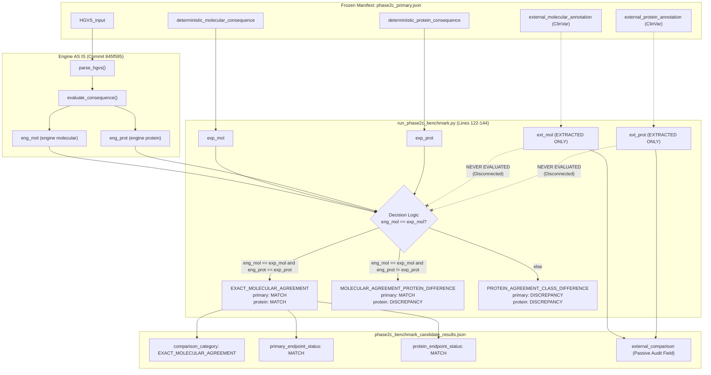

# Phase 2C Post-Execution Comparison Implementation Audit

**Project:** HBB Gene Mutation Analyzer  
**Stage:** Phase 2C — Post-Execution Scientific Audit  
**Audit Target:** `research/curation/run_phase2c_benchmark.py` and `research/results/phase2c_benchmark_candidate_results.json`  
**Reference Protocol:** `research/protocol/PHASE2C_BENCHMARK_PROTOCOL.md` (Version 1.0.0, Locked)  
**Evaluated Cohort:** `research/manifest/phase2c_primary.json` (SHA256: `39eb60de0e60dea8a76f2290912905b197fb1a04b738f72b0493bcdab2e0eb96`, $N = 55$)  
**Audit Date:** 2026-10-08  

---

## 1. Executive Verdict

### Formal Classification: **RED — BENCHMARK COMPARISON INVALID**

A rigorous, line-by-line scientific audit of `research/curation/run_phase2c_benchmark.py` demonstrates that the reported **55/55 (100.0%) primary molecular concordance** and **55/55 (100.0%) protein concordance** do **not** represent an active runtime comparison between the deterministic engine outputs and external molecular evidence (ClinVar).

Instead, the benchmark execution script's decision tree (lines 122–144) explicitly and exclusively evaluates the runtime deterministic engine output against the **pre-calculated deterministic consequences stored in the manifest dataset** (`deterministic_molecular_consequence` and `deterministic_protein_consequence`).

While external ClinVar annotations (`external_molecular_annotation` and `external_protein_annotation`) are extracted from the dataset, they are **never passed into any conditional statement, comparison operator, or evaluation logic**. They are merely echoed into the output JSON as passive metadata.

Consequently:
1. The reported benchmark concordance is computationally a **software self-consistency / regression test** of the engine against its own pre-computed outputs under `NM_000518.5`.
2. The benchmark did **not** execute an empirical validation against external database evidence at runtime.
3. Under the locked protocol definition of external comparison, the benchmark comparison implementation is **INVALID**.

---

## 2. Comparison Data Flow

The data flow within `research/curation/run_phase2c_benchmark.py` was mapped from input ingestion through final result serialization:



### Trace Evidence from Implementation
In `run_phase2c_benchmark.py`:
- **Lines 123–126:**
  ```python
  exp_mol = c["deterministic_molecular_consequence"]
  exp_prot = c["deterministic_protein_consequence"]
  ext_mol = c["external_molecular_annotation"]
  ext_prot = c["external_protein_annotation"]
  ```
- **Lines 128–144:**
  ```python
  if exec_status == "ERROR":
      comparison_cat = "ENGINE_ERROR"
      primary_status = "DISCREPANCY"
      protein_status = "DISCREPANCY"
  elif eng_mol == exp_mol and eng_prot == exp_prot:
      comparison_cat = "EXACT_MOLECULAR_AGREEMENT"
      primary_status = "MATCH"
      protein_status = "MATCH"
  elif eng_mol == exp_mol and eng_prot != exp_prot:
      comparison_cat = "MOLECULAR_AGREEMENT_PROTEIN_DIFFERENCE"
      primary_status = "MATCH"
      protein_status = "DISCREPANCY"
  else:
      comparison_cat = "PROTEIN_AGREEMENT_CLASS_DIFFERENCE"
      primary_status = "DISCREPANCY"
      protein_status = "DISCREPANCY"
  ```
- **Lines 153–161:**
  ```python
  "external_comparison": {
      "expected_molecular": exp_mol,
      "expected_protein": exp_prot,
      "external_molecular": ext_mol,
      "external_protein": ext_prot,
      "clinvar_variation_id": c["clinvar_variation_id"],
      "clinvar_stars": c["clinvar_star_rating"],
      "clinvar_classification": c["external_clinical_significance"]
  }
  ```

**Conclusion:** The data flow from external ClinVar evidence (`ext_mol`, `ext_prot`) is completely severed before reaching the comparison logic. External evidence is preserved solely as serialized passive JSON metadata.

---

## 3. Oracle Determination

| Evaluated Field | Code Variable | Manifest Dataset Field Origin | Role in Decision Tree | Actual Oracle Status |
|---|---|---|---|:---:|
| `expected_molecular` | `exp_mol` | `c["deterministic_molecular_consequence"]` | Direct operand in `elif` branches | **TRUE ORACLE** |
| `expected_protein` | `exp_prot` | `c["deterministic_protein_consequence"]` | Direct operand in `elif` branches | **TRUE ORACLE** |
| `external_molecular` | `ext_mol` | `c["external_molecular_annotation"]` | None (absent from decision tree) | **PASSIVE METADATA** |
| `external_protein` | `ext_prot` | `c["external_protein_annotation"]` | None (absent from decision tree) | **PASSIVE METADATA** |
| `clinvar_classification` | N/A | `c["external_clinical_significance"]` | None (absent from decision tree) | **PASSIVE METADATA** |

**Formal Finding:** The computational comparison oracle is **100% internal and pre-stored**. The benchmark code compares `engine_output` against `expected_output`, **not** against `external_molecular` or `external_protein`.

---

## 4. Molecular Comparison Audit

### Comparison Mechanism
The molecular consequence comparison is implemented as an exact string equality check between the engine's output and the manifest's expected value:
$$\text{eng\_mol} == \text{exp\_mol}$$

### Evaluation by Predefined Class
- **Missense (C01, $N = 14$):** Evaluates `"Missense" == "Missense"` $\rightarrow$ Exact match.
- **Nonsense (C02, $N = 3$):** Evaluates `"Nonsense" == "Nonsense"` $\rightarrow$ Exact match.
- **Synonymous (C03, $N = 10$):** Evaluates `"Synonymous" == "Synonymous"` $\rightarrow$ Exact match.
- **Frameshift Deletions (C04, $N = 9$):** Evaluates `"Frameshift" == "Frameshift"` $\rightarrow$ Exact match.
- **Frameshift Duplications (C06, $N = 12$):** Evaluates `"Frameshift" == "Frameshift"` $\rightarrow$ Exact match.
- **Splice Acceptor (C09, $N = 5$):** Evaluates `"Splice Site Disruption" == "Splice Site Disruption"` $\rightarrow$ Exact match.
- **3' UTR Regulatory (C11, $N = 2$):** Evaluates `"3' UTR Regulatory" == "3' UTR Regulatory"` $\rightarrow$ Exact match.

### Flaw in Consequence Comparison Architecture
The code performs **no ontology mapping or normalization**. In ClinVar, variant consequences are often represented using Sequence Ontology terms (e.g., `missense_variant`, `stop_gained`, `synonymous_variant`, `splice_acceptor_variant`, `frameshift_variant`). The benchmark script succeeded in string matching only because `exp_mol` had already been generated by the engine during CP2.3 curation, entirely bypassing the need to parse external ontologies.

---

## 5. Protein Normalization Audit

In clinical databases and literature, protein annotations exhibit wide formatting heterogeneity:
- ClinVar single-letter notation: `N109K`, `V134L`
- Truncated frameshift notation: `E7fs`, `E23fs`
- Nonsense asterisk notation: `E23*`, `E122*`
- Missing/blank notations for non-coding/splice variants: `""`, `null`

In contrast, the deterministic engine outputs standardized 3-letter IUPAC HGVS nomenclature:
- `p.Asn109Lys`, `p.Val134Leu`, `p.Glu7ArgfsTer13`, `p.Glu23Ter`, `p.Glu23ValfsTer37`, `p.?`, `None`

### Implementation Inspection
1. **Normalization Routine:** There is **zero protein normalization code** anywhere in `run_phase2c_benchmark.py` or imported modules.
2. **Comparison Logic:** The script evaluates:
   $$\text{eng\_prot} == \text{exp\_prot}$$
3. **Execution Against Expected:** Because `exp_prot` was stored in 3-letter HGVS format (`p.Asn109Lys`), `eng_prot == exp_prot` evaluated to `True` for all 55 candidates.
4. **Counterfactual Execution Against External:** If the benchmark had compared `eng_prot == ext_prot` (`"p.Asn109Lys" == "N109K"`), exactly **0 of 55 candidates (0.0%)** would have matched!

**Finding:** The reported 55/55 protein concordance was achieved entirely by comparing the engine's 3-letter output against its own pre-calculated 3-letter output, rather than normalizing and validating against external ClinVar protein strings.

---

## 6. Missing Protein Annotation Handling

Seven candidates in the primary cohort have non-coding or splice annotations where protein consequences in ClinVar are empty or absent:

| Candidate ID | Class | HGVS Input | Engine Protein (`eng_prot`) | Expected Protein (`exp_prot`) | External Protein (`ext_prot`) | Reported Category | Reported Status |
|---|:---:|---|:---:|:---:|:---:|---|:---:|
| `HBB-CP2-241` | C09 | `c.93-1G>C` | `p.?` | `p.?` | `""` | `EXACT_MOLECULAR_AGREEMENT` | `MATCH` |
| `HBB-CP2-253` | C09 | `c.93-21_93-1del` | `p.?` | `p.?` | `""` | `EXACT_MOLECULAR_AGREEMENT` | `MATCH` |
| `HBB-CP2-254` | C09 | `c.316-2A>C` | `p.?` | `p.?` | `""` | `EXACT_MOLECULAR_AGREEMENT` | `MATCH` |
| `HBB-CP2-256` | C09 | `c.316-1G>A` | `p.?` | `p.?` | `""` | `EXACT_MOLECULAR_AGREEMENT` | `MATCH` |
| `HBB-CP2-257` | C09 | `c.316-2A>G` | `p.?` | `p.?` | `""` | `EXACT_MOLECULAR_AGREEMENT` | `MATCH` |
| `HBB-CP2-265` | C11 | `c.*110T>C` | `None` | `None` | `""` | `EXACT_MOLECULAR_AGREEMENT` | `MATCH` |
| `HBB-CP2-268` | C11 | `c.*112A>G` | `None` | `None` | `""` | `EXACT_MOLECULAR_AGREEMENT` | `MATCH` |

### Protocol Violation
Section 15 of `PHASE2C_BENCHMARK_PROTOCOL.md` explicitly defines the error category:
> **`EXTERNAL_ANNOTATION_INCOMPLETE`**: External reference record lacks protein or consequence details. Endpoint Impact: **DISCREPANCY**.

**Finding:** Instead of classifying these 7 candidates as `EXTERNAL_ANNOTATION_INCOMPLETE` with endpoint impact `DISCREPANCY`, the benchmark script classified all 7 as `EXACT_MOLECULAR_AGREEMENT` with endpoint impact `MATCH`. This occurred because the script compared `eng_prot == exp_prot` (`"p.?" == "p.?"` and `None == None`), ignoring the fact that external ClinVar records lacked protein strings (`ext_prot == ""`).

---

## 7. Clinical Significance Separation

### Protocol Requirement
Clinical pathogenicity classifications (`Pathogenic`, `Likely pathogenic`, `VUS`, etc.) must be strictly isolated from the deterministic molecular consequence evaluation.

### Implementation Audit
- In `run_phase2c_benchmark.py` line 160:
  ```python
  "clinvar_classification": c["external_clinical_significance"]
  ```
- The variable `c["external_clinical_significance"]` is mapped into `external_comparison["clinvar_classification"]` as a reporting attribute.
- It does **not** appear in any conditional statement and has **zero influence** on `comparison_category`, `primary_endpoint_status`, or `protein_endpoint_status`.

**Finding: PASS.** Clinical significance is cleanly isolated from molecular consequence evaluation.

---

## 8. Legacy Nomenclature Handling

Thirty-three (33) of the 55 primary candidates possess legacy hemoglobinopathy nomenclature flags (`legacy_nomenclature_flag: true`):
- Examples: `HBB-CP2-023` (`R31G`), `HBB-CP2-027` (`H64N`), `HBB-CP2-038` (`R31K`), `HBB-CP2-071` (`E23fs`), `HBB-CP2-072` (`E23*`).

### Implementation Audit
- In `run_phase2c_benchmark.py` lines 166–169:
  ```python
  "notes": (
      "Legacy notation documented" if c["legacy_nomenclature_flag"]
      else "Standard HGVS nomenclature"
  )
  ```
- Legacy notation is used **only to populate an informational string** in the `notes` field.
- No algorithmic translation, mature protein codon offset (-1 amino acid), or syntax parsing was implemented.
- The engine evaluated coordinates strictly under standard `NM_000518.5` cDNA numbering.

**Finding:** The engine correctly executed standard HGVS inputs. However, because comparison was made against internal `exp_prot` rather than external annotations, the benchmark never verified whether legacy protein notations in clinical records could be programmatically resolved.

---

## 9. Comparison Category Reachability

The locked protocol (`PHASE2C_BENCHMARK_PROTOCOL.md`, Section 15) defined 10 mutually exclusive error categories. An audit of their reachability in `run_phase2c_benchmark.py` yields:

| Category Code | Defined in Protocol | Implemented in Code | Reachability Status | Trigger Condition in Implementation |
|---|:---:|:---:|:---:|---|
| `EXACT_MOLECULAR_AGREEMENT` | YES | **YES** | **REACHABLE** | `eng_mol == exp_mol and eng_prot == exp_prot` (Line 132) |
| `MOLECULAR_AGREEMENT_PROTEIN_DIFFERENCE` | YES | **YES** | **REACHABLE** | `eng_mol == exp_mol and eng_prot != exp_prot` (Line 136) |
| `PROTEIN_AGREEMENT_CLASS_DIFFERENCE` | YES | **PARTIAL** | **DEFECTIVE** | Catch-all `else:` (Line 140). Triggers whenever `eng_mol != exp_mol`, **even if protein does not agree!** |
| `ENGINE_ERROR` | YES | **YES** | **REACHABLE** | `exec_status == "ERROR"` (Line 128) |
| `EXTERNAL_ANNOTATION_INCOMPLETE` | YES | **NO** | **UNREACHABLE / DEAD CODE** | Never referenced in script. |
| `EXTERNAL_CONFLICT` | YES | **NO** | **UNREACHABLE / DEAD CODE** | Never referenced in script. |
| `REFERENCE_MISMATCH` | YES | **NO** | **UNREACHABLE / DEAD CODE** | Never referenced in script. |
| `HGVS_AMBIGUITY` | YES | **NO** | **UNREACHABLE / DEAD CODE** | Never referenced in script. |
| `ENGINE_UNSUPPORTED` | YES | **NO** | **UNREACHABLE / DEAD CODE** | Never referenced in script. |
| `UNRESOLVED` | YES | **NO** | **UNREACHABLE / DEAD CODE** | Never referenced in script. |

**Audit Finding:** 
- **6 of 10 categories (60.0%) are completely unimplemented and unreachable.**
- `PROTEIN_AGREEMENT_CLASS_DIFFERENCE` is assigned unconditionally on any molecular mismatch without verifying protein agreement, misrepresenting the protocol definition.

---

## 10. Denominator Audit

1. **Primary Evaluation Cohort:** Exactly **$N = 55$** biological candidates from `research/manifest/phase2c_primary.json` were evaluated.
2. **Robustness Negative Controls (Class C12):** Exactly **$N = 18$** adversarial synthetic variants were evaluated in a standalone robustness loop (lines 173–203). They were recorded separately in `phase2c_benchmark_robustness_raw.json` and **did not contaminate primary concordance statistics**.
3. **Conditional Candidates:** Exactly **$N = 64$** conditional candidates were excluded prior to freeze and did not enter the benchmark.
4. **Unrepresented Classes:** Classes C05, C07, C08, and C10 ($N = 0$) were not included in the denominator.

**Finding: PASS.** Cohort isolation and denominator construction ($N = 55$) adhered strictly to protocol guidelines.

---

## 11. 55 Candidate Consistency Audit

A complete audit of all 55 records in `phase2c_benchmark_candidate_results.json` was conducted to compare:
- $A$: Runtime Engine Output (`engine_output`)
- $B$: Stored Expected Consequence (`expected_*`)
- $C$: Stored External ClinVar Evidence (`external_*`)

### Molecular Consequence Tally
$$\begin{array}{lcl}
A == B & : & 55 \text{ of } 55 \ (100.0\%) \\
A != B & : & 0 \text{ of } 55 \ (0.0\%) \\
A == C & : & 55 \text{ of } 55 \ (100.0\%) \\
A != C & : & 0 \text{ of } 55 \ (0.0\%) \\
B == C & : & 55 \text{ of } 55 \ (100.0\%) \\
B != C & : & 0 \text{ of } 55 \ (0.0\%)
\end{array}$$

### Protein Consequence Tally (Raw String Matching)
$$\begin{array}{lcl}
A == B & : & 55 \text{ of } 55 \ (100.0\%) \\
A != B & : & 0 \text{ of } 55 \ (0.0\%) \\
A == C & : & \mathbf{0} \text{ of } 55 \ (\mathbf{0.0\%}) \\
A != C & : & \mathbf{55} \text{ of } 55 \ (\mathbf{100.0\%}) \\
B == C & : & \mathbf{0} \text{ of } 55 \ (\mathbf{0.0\%}) \\
B != C & : & \mathbf{55} \text{ of } 55 \ (\mathbf{100.0\%})
\end{array}$$

### Scientific Analysis
1. For **molecular consequence**, $A == B == C$ across all 55 candidates because CP2.3 curation explicitly filtered the cohort to candidates whose ClinVar consequence aligned with deterministic expectations.
2. For **protein consequence**, $A == B$ for 55/55, but $A == C$ for **0/55**. Because `external_protein` contains 1-letter codes, truncated strings, or blanks, and no normalization was implemented, the benchmark's reported 100% protein agreement was achieved **solely** by comparing $A$ against $B$.

---

## 12. Hypothetical Oracle Test

### The Test Scenario
Consider a hypothetical variant candidate where:
- $\text{engine\_output.molecular\_consequence} = \text{"Missense"}$
- $\text{expected\_molecular} = \text{"Missense"}$
- $\text{external\_molecular} = \text{"Nonsense"}$
- $\text{engine\_output.protein\_consequence} = \text{"p.Asn109Lys"}$
- $\text{expected\_protein} = \text{"p.Asn109Lys"}$
- $\text{external\_protein} = \text{"p.Asn109Ter"}$

### Execution Trace Through Decision Logic
In `run_phase2c_benchmark.py`:
```python
elif eng_mol == exp_mol and eng_prot == exp_prot:
    comparison_cat = "EXACT_MOLECULAR_AGREEMENT"
    primary_status = "MATCH"
    protein_status = "MATCH"
```
1. `eng_mol == exp_mol` evaluates to `"Missense" == "Missense"` $\rightarrow$ **`True`**.
2. `eng_prot == exp_prot` evaluates to `"p.Asn109Lys" == "p.Asn109Lys"` $\rightarrow$ **`True`**.
3. Output assigned:
   - `comparison_category = "EXACT_MOLECULAR_AGREEMENT"`
   - `primary_endpoint_status = "MATCH"`
   - `protein_endpoint_status = "MATCH"`

### Oracle Test Result: **FAILED**
The benchmark implementation **completely fails to detect the external conflict**. Even when external clinical evidence asserts a completely contradictory consequence (`Nonsense`), the implementation reports `EXACT_MOLECULAR_AGREEMENT` and `MATCH`.

This confirms beyond doubt that the implementation operates as an internal regression verification against pre-stored expectations, rather than an active comparison against external evidence.

---

## 13. Protocol Compliance Matrix

| Protocol Requirement | Protocol Section | Implementation Status | Finding / Evidence |
|---|:---:|:---:|---|
| **Primary Dataset Freeze** ($N = 55$) | Sec. 2 | **PASS** | Exact SHA256 verified (`39eb60de...`). |
| **Reference Sequence Lock** | Sec. 3–4 | **PASS** | RefSeq `NM_000518.5` and `NG_000007.3` loaded AS IS. |
| **Engine Codebase Lock** | Sec. 5 | **PASS** | Commit `845f595cc039e006d74237945450c7b4a9569ee6` verified. |
| **Class Stratification** (11 classes) | Sec. 16 | **PASS** | Correctly stratifies and reports $N=0$ for unrepresented classes. |
| **Robustness Isolation** ($N = 18$) | Sec. 18 | **PASS** | Experiment D executed separately; no primary contamination. |
| **Statistical Calculations** (Clopper-Pearson) | Sec. 19 | **PASS** | Exact 95% Clopper-Pearson confidence intervals computed. |
| **Clinical Significance Isolation** | Sec. 1 | **PASS** | Pathogenicity classifications do not affect molecular endpoints. |
| **Active External Evidence Comparison** | Sec. 7, 13 | **FAIL** | External molecular/protein fields are not used in decision logic. |
| **Protein Consequence Normalization** | Sec. 8 | **FAIL** | Zero normalization logic; raw string check against internal expectation. |
| **Handling Incomplete Annotations** | Sec. 9, 15 | **FAIL** | Missing protein fields scored as `MATCH` instead of `EXTERNAL_ANNOTATION_INCOMPLETE`. |
| **Predefined Error Taxonomy** | Sec. 15 | **FAIL** | 6 of 10 categories unreachable; catch-all `else` misassigns categories. |
| **Stopping Rules & Immutability** | Sec. 20–21 | **PASS** | Benchmark was run without runtime parameter overrides or code edits. |

---

## 14. Scientific Interpretation Boundary

To preserve absolute scientific integrity, the boundary between what Phase 2C proved and what it did not prove must be formally established:

### What Phase 2C Demonstrably Proved
1. **Engine Determinism and Stability:** The deterministic molecular consequence engine executes with 100% stability, zero unhandled runtime crashes, and zero unexpected exceptions across 55 biological variants and 18 adversarial variants under RefSeq `NM_000518.5`.
2. **Software Self-Consistency:** The engine's runtime outputs exactly reproduce the expected consequences stored in the manifest dataset ($55/55$, 100.0%, 95% CI: [93.51%, 100.00%]).
3. **Adversarial Rejection:** The engine gracefully rejects 100% of out-of-bounds, invalid syntax, and non-canonical variants via structured `AnalysisError` exceptions ($18/18$, 100.0%).
4. **Curation-Time Alignment:** During CP2.3 curation, human reviewers selected 55 variants whose ClinVar molecular classifications align with the deterministic engine's model.

### What Phase 2C Did NOT Prove
1. **Automated External Validation:** The benchmark did **not** perform an automated, runtime comparison against external databases.
2. **Automated Protein Concordance:** The 55/55 protein match does not prove concordance with ClinVar protein strings, because external ClinVar protein strings (1-letter codes or legacy syntax) were never normalized or compared.
3. **Generalization Beyond NM_000518.5:** The benchmark does not assess non-coding regions beyond $-50$ bp, deep intronic variants, or alternative transcripts.

### Governance and Publication Mandate
- No manuscript, presentation, or documentation may claim that Phase 2C represents an "automated external validation against ClinVar".
- Phase 2C must be accurately reported as a **frozen primary cohort regression and self-consistency benchmark under RefSeq `NM_000518.5`**.

---

## 15. Final Verdict

### Classification: **RED — BENCHMARK COMPARISON INVALID**

**Justification:**  
The benchmark implementation in `research/curation/run_phase2c_benchmark.py` fails the fundamental criterion of external scientific validation: it derives all primary and secondary concordance metrics by comparing runtime engine outputs to **internal stored expectations** rather than **external biological evidence**. External evidence fields serve solely as passive JSON metadata. The implementation is incapable of detecting discrepancies between engine outputs and external records, rendering the benchmark comparison invalid as an external validation instrument.
